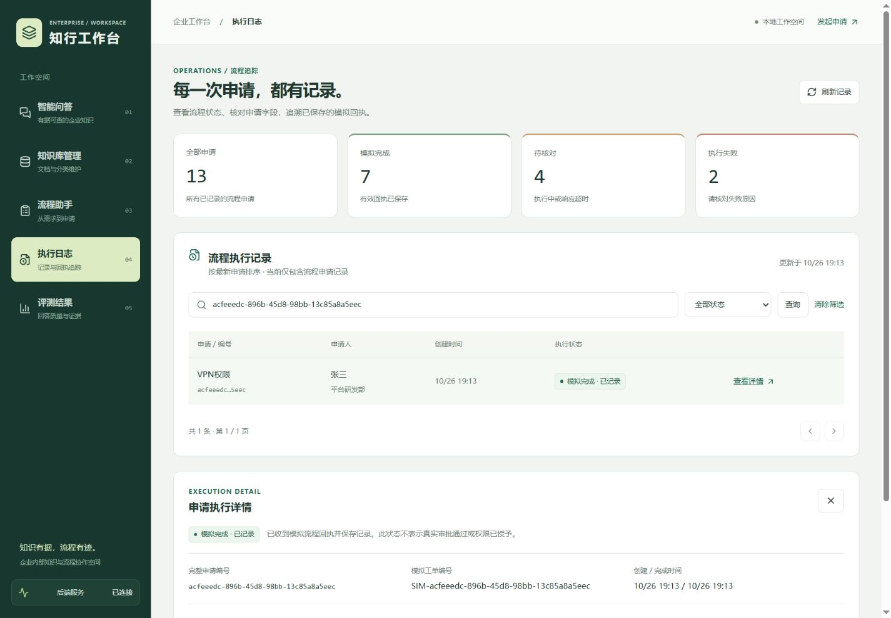
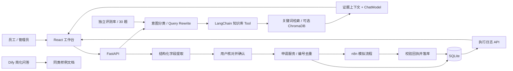

# 知行工作台 · 企业知识与流程助手

一个面向企业内部资料查询和轻量流程辅助的 RAG + Agent 项目。以 React 工作台为主要入口，用 FastAPI、LangChain、SQLite 与可选 ChromaDB 串起文档入库、引用回答、字段提取、n8n 模拟流程和执行记录；另用 Dify 复刻简化知识问答，比较代码实现与低代码交付。



## 可以演示什么

- **知识问答**：上传分类文档，进行意图判断与 Query Rewrite，通过知识库 Tool 检索，展示回答、来源片段和实际检索方式。
- **执行摘要**：每条完整回答保留追踪编号、业务路由、检索结果和阶段耗时，刷新后可核对；跳过检索、拒答与模型回答分别展示。
- **流程申请**：提取六字段，允许修改与补充；确认后调用 n8n Webhook，先保存申请、校验回执再记录结果，按申请编号防止重复提交。
- **无依据拒答**：资料没有所问事实时明确说明缺少依据；不把“未找到”解释为“未披露”或“不存在”。
- **执行记录**：从 SQLite 读取真实申请，支持状态筛选、编号查询、分页、详情与超时提示。
- **可复核评测**：30 题覆盖 HR、财务、IT、产品、流程申请和无依据拒答，区分离线检索基线与真实模型输出。
- **回答反馈**：对已保存的回答标记有帮助或无帮助、选择问题原因并补充说明；评测页按状态处理负反馈，记录复核说明，并回到原会话核对。

当前为本机演示项目：n8n 生成模拟表格、通知和工单，不执行真实审批、通知或授权。React 的知识库上传入口支持 `.md` / `.txt`，单文件上限 2MB；旧版 Streamlit 入口保留附加文本处理及会话界面。

## 架构



这是逻辑架构；容器代理、数据流与持久化说明见 [架构说明](docs/architecture.md)。Dify 是独立对照应用，原系统不通过 Dify 回答问题。

## 本地开发启动

在项目根目录操作。后端建议使用 Python 3.11；本机既有 Python 3.13 虚拟环境也已完成单元测试。前端使用 Node.js 22.12+ 的 22.x 版本及 npm。已有可用 `.venv` 时跳过创建步骤。

```powershell
py -3.11 -m venv .venv
.venv\Scripts\python.exe -m pip install -r requirements.txt
if (!(Test-Path .env)) { Copy-Item .env.example .env }
```

编辑 `.env` 中的模型配置：`DEEPSEEK_API_KEY`、`BASE_URL`、`LLM_MODEL`。示例使用官方 DeepSeek API 地址；接兼容服务时按实际地址与可用模型填写。[DeepSeek 配置说明](https://api-docs.deepseek.com/)

示例默认 `RAG_RETRIEVAL_MODE=keyword`，便于先跑通。选择 `vector` 后需要可用的 Embedding 服务或本地模型；首次加载本地模型需下载权重，实际检索方式会记录在结果中。

```powershell
.venv\Scripts\python.exe -m uvicorn backend.main:app --reload --host 127.0.0.1 --port 18000
```

另一个终端：

```powershell
cd frontend-react
npm ci
npm run dev
```

打开 Vite 输出的地址，通常为 [工作台](http://localhost:5173)。默认 `/api` 代理至 `http://127.0.0.1:18000`，可在 `frontend-react/.env.local` 设置 `BACKEND_PROXY_TARGET` 后重启 Vite。后端启动时初始化 SQLite；[健康检查](http://127.0.0.1:18000/health) 与 [API 文档](http://127.0.0.1:18000/docs) 可单独访问。

## Docker 启动

先启动 Docker Desktop 的 Linux 引擎，准备好 `.env`，再执行：

```powershell
docker compose config --quiet
docker compose up -d --build backend web
```

| 入口 | 默认本机地址 | 说明 |
| --- | --- | --- |
| React 工作台 | [localhost:8080](http://localhost:8080) | Nginx 提供静态页面并代理 `/api` |
| FastAPI | [127.0.0.1:18000/docs](http://127.0.0.1:18000/docs) | 容器内部仍监听 8000 |
| n8n（可选） | [localhost:5678](http://localhost:5678) | 需导入模板、绑定 Header Auth 并发布 |
| Dify（独立部署） | [localhost:18080](http://localhost:18080) | 见独立部署说明 |

默认 Compose 启动 React 与后端；旧版 Streamlit 使用 `legacy-streamlit` profile，可通过 `docker compose --profile legacy-streamlit up -d --build frontend` 启动，端口 8501。端口覆盖、数据保存、SSE 代理、升级和排错见 [部署说明](docs/deployment.md)。

本机第 27 天检查中 React 镜像构建成功，但后端构建期间 Docker containerd 崩溃，CPU 后端与整套容器联调尚未验证。实际通过项和受阻项见 [交付记录](docs/day27_delivery.md)。

## 接入 n8n 与 Dify

```powershell
docker compose --profile automation up -d n8n
```

按 [n8n 配置说明](docs/day19_n8n_webhook.md) 导入 [工作流模板](integrations/n8n/process_application.json)，设置 `X-Webhook-Token` Header Auth 并发布。宿主机 FastAPI 使用 `http://127.0.0.1:5678/webhook/process-application`；同一 Compose 内的 FastAPI 使用 `http://n8n:5678/webhook/process-application`。`.env` 的 Token 必须与凭据一致，修改后重启后端使其生效。

Dify 不随根 Compose 启动。按 [Dify 部署与导入说明](integrations/dify/README.md) 创建独立实例、知识库与模型配置，使用已导出的应用 DSL。对比见 [FastAPI vs Dify](docs/day23_fastapi_vs_dify.md)。

## 测试与效果记录

```powershell
# 单元测试：模拟外部模型与 n8n，不触发真实申请
.venv\Scripts\python.exe -m unittest discover -s tests -v

# 离线规则路由 + 真实检索
.venv\Scripts\python.exe eval/run_week4.py --mode offline --output eval/local/offline_report.json

# 真实模型 Agent（需要已配置模型服务）
.venv\Scripts\python.exe eval/run_week4.py --mode live --output eval/local/live_report.json
```

前端在 `frontend-react` 目录执行 `npm run build` 与 `npm run lint`。旧的 `eval/run_eval.py` 仍服务于旧语料，不代表第四周结果。

2026-10-26 的修复后单次真实模型基线（`deepseek-chat`、keyword、top_k=3）：

| 指标 | 结果 |
| --- | --- |
| 检索来源命中 | 20/20 |
| 答案引用命中 | 20/20 |
| 答案关键词事实组覆盖 | 50/50 |
| 无依据拒答 | 5/5，Codex 逐条阅读复核 |
| 流程意图二分类 | 30/30 |
| 六类路由完全匹配 | 25/30 |

这些是有限样例下的指标，不能等同于所有问题的准确率；引用指标不逐句判断蕴含关系，关键词覆盖不等于完整语义正确。语料哈希、逐题回答、失败分析、拒答复核和运行边界见 [评测说明](docs/day25_evaluation.md)与[修复对照](docs/week4_eval_fixes.md)。更换模型后应重新评测。前端评测页显示构建时快照。

## 演示与交付资料

- [3 分钟演示脚本](docs/demo_script_3min.md)：知识问答、流程申请、无依据拒答三条链路。
- [第 26 天 UI 与日志验收](docs/day26_workspace_ui.md)：桌面、手机、超时和隔离测试记录。
- [12 份虚拟知识文档](docs/sample_knowledge_base/README.md)：按 HR、财务、IT、产品分类。
- [第 27 天交付检查](docs/day27_delivery.md)：本轮构建与部署验证范围。
- [多会话管理验收](docs/chat_sessions.md)：新建、命名、历史与引用恢复、流式隔离、删除边界。
- [回答反馈验收](docs/answer_feedback.md)：消息编号、反馈持久化、问题原因与评测页查看。
- [回答执行摘要](docs/answer_execution.md)：计时边界、异常展示与历史恢复验收。
- [求职展示渐进优化](docs/portfolio_improvements.md)：后续按质量、稳定性和可复现演示逐步推进。
- [产品路由修复对照](docs/product_routing_improvement.md)：原 30 题从 25/30 到 28/30，另有 8 题相似表达回归；仅评测路由。
- [安全规范路由修复对照](docs/security_routing_improvement.md)：原 30 题从 28/30 到 29/30，安全回归 4/8 到 8/8；同题报告及实际检索过滤回归。

## 项目范围

后端已持久化会话、消息、文档、检索与流程记录；React 支持新建、命名、切换、删除和恢复最近 50 个知识问答会话及引用。会话地址带编号，刷新或浏览器前进后退可恢复对应历史。知识库角色是演示约定，未实现完整登录、多租户与员工级访问隔离。执行日志页目前只聚合流程申请；统一的业务全链路 Trace 仍待完善。

项目用于学习、工程能力验证与求职展示。已实现的模块为后续扩展提供基础，未实现的审批、授权、真实通知和复杂 Agent 编排不作为现有能力描述。
