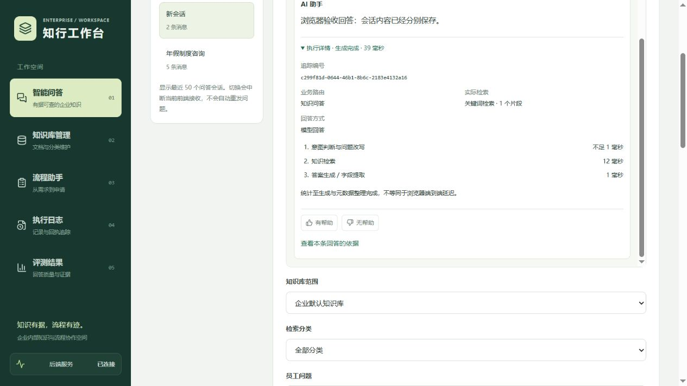

# 每条回答的执行摘要

本轮面向求职演示补充可核对的运行过程：在完整回答下展开“执行详情”，查看本次追踪编号、业务路由、实际检索方式、命中片段数、回答方式和三个阶段的耗时。成功回答的摘要随消息元数据保存，刷新后恢复同一份数据，不重新计算。

## 演示方式

1. 提问“年假应该提前多久申请？”，等待回答后展开执行详情。核对“知识问答”、实际检索方式、命中片段数，再展开本条回答的引用来源。
2. 提问普通对话问题，检查摘要显示跳过检索；跳过阶段不伪造成一次成功的检索。
3. 对缺少可靠知识依据的问题，检查“回答方式”为明确拒答；它与模型生成答案、流程字段提取区分记录。
4. 刷新当前会话，核对追踪编号和阶段耗时保持一致；切换会话时每条摘要各自关联原回答。

历史消息没有摘要时不生成虚构编号和耗时。恢复历史后，右侧检索信息也显示已保存的结果，不继续显示“等待检索结果”。旧版 Streamlit 使用的 `POST /chat_history` 同时修正：复用当前消息查询，恢复消息编号、反馈与执行摘要，避免缺少字段导致异常。

## 统计边界

- 每次 Agent 执行生成独立 UUID，同一次执行的 `workflow_start`、成功 `final` 或异常 `error` 使用相同编号。前端从 `metadata.execution_trace` 获取摘要；成功消息持久化到 `chat_messages.metadata_json`。
- 使用单调时钟 `perf_counter`，阶段为意图判断/Query Rewrite、检索和答案生成/字段提取。检索阶段含当前检索链路、查询记录保存和展示信息整理；答案阶段包括流式生成或确定性拒答。不是模型计费时长、纯 CPU 时间或模型调用次数统计。
- 总耗时从服务端生成器开始到答案生成与元数据整理完成，不包括随后最终回答入库和 final 事件发送。流式阶段的观察时间可能包含生成器调度及接收速度的影响，因此不能把这些数值当作浏览器端到端延迟或跨机器性能基准；阶段之和也不必等于总耗时。
- 失败时 error 事件包含编号与已完成/失败阶段；未生成完整回答时不伪造成功消息。失败摘要目前仅在当前页面和服务端日志中可用，刷新不会恢复失败详情。尚未实现失败执行记录表、完整分布式追踪、token/成本统计或 n8n 链路关联。
- 服务端日志只追加编号、状态和观测耗时，不在新增追踪日志中复制问题、回答、凭据或异常详情；INFO 是否可见取决于运行环境的日志级别。

## 验证

全部 73 项 Python 离线测试通过，包含 6 项新增测试：单调计时与独立编号、普通对话跳过检索、知识命中与拒答分支、路由失败、生成失败、SSE/SQLite/旧历史接口恢复一致。流程提取测试验证其回答方式标签。8 项 Node 测试、TypeScript、ESLint 和生产构建通过。

隔离浏览器验收使用 `.venv\Scripts\python.exe tests/chat_ui_fixture.py --trace`，再设置 Vite `BACKEND_PROXY_TARGET=http://127.0.0.1:18002`。该环境使用真实 SQLite、生产 SSE 与关键词检索、样例年假文档，路由和模型输出为模拟；验证展开、刷新编号一致、错误阶段展示和 390px 布局。截图中的耗时来自此隔离环境，不代表真实模型性能。正常演示数据库未修改，Docker、n8n 和 Dify 未启动。

原有第四周评测报告仍为历史快照，本轮没有修改指标或重新运行付费模型评测。

