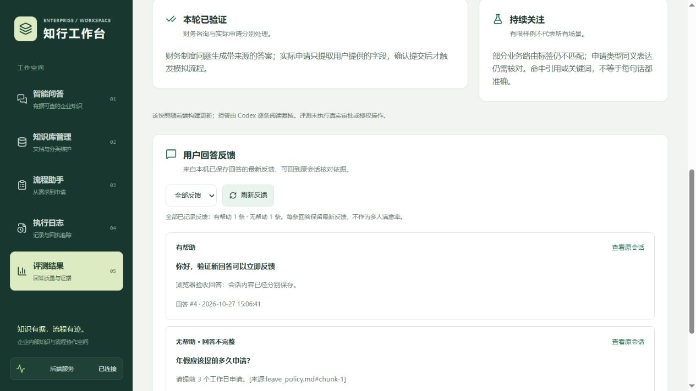

# 回答反馈闭环

智能问答的完整回答支持“有帮助 / 无帮助”，用户选择后点击“提交反馈”保存。“无帮助”需要选择答案不准确、引用不匹配、回答不完整或其他问题；可选补充说明最多 500 字。反馈不会修改原回答、重发问题或触发流程。

## 操作验收

1. 在智能问答中提问，等待完整回答；新回答完成后即可反馈，无需先刷新。
2. 点击“无帮助”，检查未选择原因时“提交反馈”不可用。选择“回答不完整”，填写说明并提交，等待显示“反馈已记录 · 无帮助”。
3. 刷新浏览器，反馈状态应恢复；再次点击可修改反馈，取消则保留原记录。
4. 进入“评测结果”，在历史评测快照下找到“用户回答反馈”。检查问题、回答、原因、说明和消息编号；通过筛选及分页查看记录。
5. 点击“查看原会话”恢复对应会话，使用原回答的“查看本条回答的依据”核对来源。

每条回答只保留一条最新反馈。重复提交更新同一记录；失败、超时不报告保存成功，也不自动重试。超时可能发生在服务端已保存之后，应先刷新历史核对。

## 数据与接口

- SSE `final.message_id` 返回真正入库的 assistant 消息编号，历史消息同时返回 `message_id` 与可选 `feedback`；不使用前端列表下标或文字匹配定位回答。
- `POST /chat_session/{session_id}/messages/{message_id}/feedback` 接收 `rating`、`reason`、`comment`。消息必须存在、属于指定会话且角色为 assistant；用户消息、跨会话编号、已删除回答返回 404，内部知识库会话返回 403。原因与长度由后端独立校验，未知字段拒绝接收。
- `GET /answer_feedback?rating=unhelpful&page=1&page_size=10` 返回最新反馈、对应问题及原回答。页面大小最多 50；总数对应当前筛选，分类计数对应全部记录。
- 启动时自动创建 `answer_feedback` 表，原会话与消息保留。`message_id` 为主键，并通过外键在消息或会话删除时级联清理。提交的归属校验及更新在同一事务中完成。

本机尚无登录与员工级鉴权，这些反馈为共享演示数据，不区分反馈人，计数不能当作多人满意率。反馈不是自动训练数据，也不会自动加入评测集或修改检索策略；后续应先人工复核问题和引用，再选择有价值的样例扩充评测。

## 验证记录

- 全部 60 项 Python 离线测试通过，其中新增 6 项覆盖幂等更新、历史恢复、归属和角色校验、输入边界、筛选分页、迁移保留、删除级联与存储异常。原有 Agent/流程测试同步验证持久化消息编号可进入 final 事件。
- 7 项 Node 客户端测试通过，包含恢复数据库消息编号和反馈状态；TypeScript、ESLint 与 Vite 生产构建通过。
- 浏览器使用 `tests/chat_ui_fixture.py`：隔离 SQLite、生产 HTTP/SSE、固定模拟模型输出。验证历史反馈提交及刷新恢复、新回答即时反馈、取消修改、评测页计数/筛选/原会话跳转；390px 窄屏无横向溢出。未访问真实模型或启动 Docker/n8n/Dify。
- 第四周 30 题模型评测仍为历史快照，本轮没有重新运行或修改结果。Agent 服务本次只增加入库消息编号返回，不宣称历史报告等同于当前代码的重新验收。

复现：项目根目录运行 `.venv\Scripts\python.exe -m unittest discover -s tests -p "test_*.py"`；前端目录运行 `npm test`、`npm run lint`、`npm run build`。浏览器验收启动 `.venv\Scripts\python.exe tests/chat_ui_fixture.py`，再设置 `BACKEND_PROXY_TARGET=http://127.0.0.1:18002` 启动 Vite。

