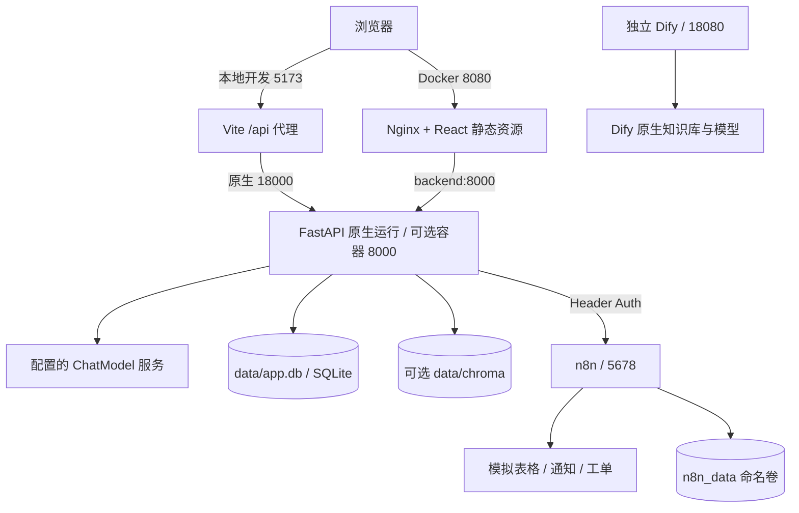
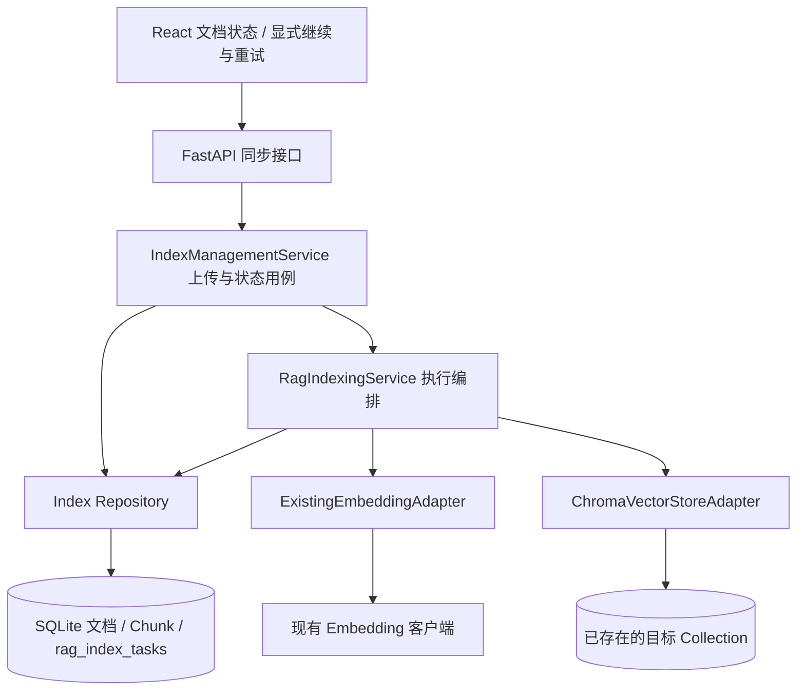
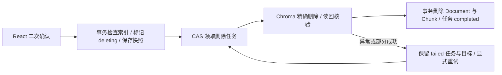
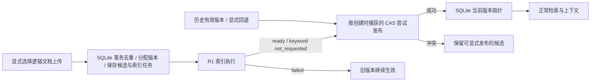
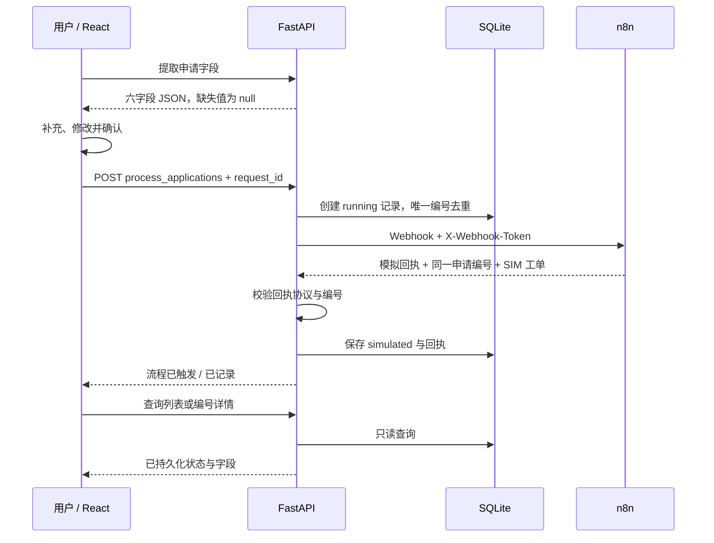

# 项目架构与数据流

当前主要入口是 React“知行工作台”。FastAPI 提供知识库、Agent、字段提取、流程提交与执行日志接口；Streamlit 是保留的旧版入口。Dify 单独部署，不参与原系统的请求处理。

## 部署视图

默认使用原生 Python + Vite，SQLite、ChromaDB 存储在本地目录，不要求 Docker。Vite 与 Nginx 是两种启动方式，按所选方式使用一个前端入口。Docker 仅作为可选部署方式保留。宿主机地址与容器服务名的区别见[部署说明](deployment.md)。

## 知识问答

1. 管理页将 `.md` / `.txt` 文本与分类发送至 `/index_document`，后端切块后原子保存文档、片段及 R1 索引任务，再按模式执行索引，详见下节。
2. Agent 对当前问题做业务分类与 Query Rewrite；模型决策失败时使用规则兜底。
3. `search_knowledge_base` StructuredTool 绑定当前请求的知识库和分类范围，只向调用方暴露 query。范围绑定不替代用户鉴权。
4. keyword 模式直接检索；vector 模式使用 Embedding 与 ChromaDB，按配置允许关键词回退。改写问题未命中时还可尝试原问题。
5. 命中片段进入模型上下文，回答按文件与 chunk 标签引用；无可靠片段时返回缺少依据的说明。即使命中片段，未包含所问细节时仍应拒答。
6. 前端通过 POST SSE 展示结果与证据；会话、消息、检索问题和命中片段保存在 SQLite。React 支持多会话及历史引用恢复。

## R1 索引管理

| 层 | 代码与职责 |
| --- | --- |
| API | `backend/api/chat.py`、`backend/api/rag_index.py`：请求校验、HTTP 映射、公开响应过滤，不直接操作 SQL |
| Service | `backend/services/rag_documents.py`：上传、作用域校验及状态投影；`rag_indexing.py`：领取、快照读取、Profile 核验与绑定、写入和结果确认 |
| Repository | `backend/db/index_repository.py` 复用 `repository.py` 的 connection-aware helper；负责短事务、CAS、稳定输入及状态，不依赖 Service |
| Adapter | `backend/rag/index_adapters.py`：复用 `embedding_client.py`、`vector_store.py`，验证向量数量、维度及 Collection 配置后 upsert；通过接口注入 Service |

文档、Chunk、任务同事务提交后才调用外部服务。向量模式创建 `pending`，关键词模式创建 `not_requested`；领取后 `attempt_token` 标识当前执行者，`state_version` 用于 CAS。执行时读取并校验输入快照，生成向量后、upsert 前绑定未知维度和距离度量，已知 Profile 配置禁止覆盖。成功确认 `ready`，异常记录 `failed` 及受控错误；写入成功但 SQLite 确认失败时返回“状态未确认”，不会伪报成功。

重试沿用原 operation/document/Chunk ID，向量 ID 为 `storage_session_id:db_chunk_id`，相同 ID upsert 覆盖，避免重复向量。同步 FastAPI 路由在线程池执行，Service 使用进程内执行名额及 120 秒协作预算；客户端断开不能证明外部调用停止，不自动抢占或重发，且预算无法强行中断所有底层同步调用。无 Redis、Celery 或后台队列。

React 用 `KnowledgeIndexController` 管理只读轮询、版本合并、取消及重复点击保护；`DocumentIndexStatus` 区分未启用、待执行、索引中、成功、失败和状态未确认。已领取 pending 只查询，未领取 pending 允许显式 resume，failed 允许显式 retry；HTTP 409 后只查询对账。人工恢复仅通过 CLI：确认所有旧执行者已停止后，将 claimed pending 标记 `failed/interrupted`，再显式 retry；它不能阻止仍存活的旧进程继续写 Chroma。

R1 不涵盖删除一致性、文档版本及权限重构，也不自动补齐历史任务或重建 Collection。历史业务 Collection 虽只读确认维度 1024、度量 l2，但模型来源不明，不能据此确认与新模型语义兼容。状态及接口见 [数据协议](data_contract.md#6-r1-索引任务与管理接口)，验收范围见 [记录](day27_delivery.md#r1-原生环境最终验收2026-11-03)。

## R2 单文档删除

沿用 API → Service → Repository / Adapter 分层：`backend/api/document_deletion.py` 负责 HTTP；`services/document_deletion.py` 校验权限、协调删除与确认；`db/deletion_repository.py` 管理 SQLite 事务、CAS 和独立任务；`rag/deletion_adapter.py` 只按稳定 ID 删除并读回核验，不调用 Embedding。

Document 的 `lifecycle_state` 为 `active/deleting`，与业务 `process_status`、R1 索引状态分开。删除请求在同一短事务中检查索引是否已领取、标记 deleting、保存完整 Vector ID/目标存储快照并使旧索引版本失效。独立 `document_deletion_tasks` 无 Document 外键，删除文档和 Chunk 后仍保留目标及回执。

已领取索引与删除互斥，返回 409；未领取的索引即使拿到新版本号，也因生命周期条件无法 claim/retry，删除中不能复用上传。SQLite 物理删除与任务 completed 同事务完成；Chroma 已删但 SQLite 失败时保留 deleting 和目标，重试可再次删除同一组 ID。SQLite 与 Chroma 没有跨库原子事务，采用可恢复的幂等流程；不会根据当前 keyword/vector 模式跳过历史向量清理。

关键词读取排除 deleting；向量检索先用 SQLite 活动文档 ID 白名单过滤，再回查 Chunk、正文与元数据；构造 Agent 上下文前再次核对。不存在或删除中的文档不能作为新检索证据，检索日志插入跳过失效 Chunk，避免删除竞争引发外键异常。历史已保存回答不在本轮自动清除。

React `DocumentDeletionControls` / `DocumentDeletionController` 提供确认弹窗、状态查询、失败重试和未领取 pending 的显式继续。claimed pending 只查询；删除通知通过 `KnowledgeIndexController.refreshAfterDocumentChange()` 使旧列表 GET 失效，再获取最新列表，避免删除成功后旧数据重新显示。

旧会话清空能力保留，API 与共享清理入口均拒绝 `knowledge_base:` 内部 session，不提供公共知识库批量清空。claimed 删除任务因进程中断停留时，操作人员确认旧执行者已停止后才能用 CLI 转 failed，再显式 retry；无自动超时接管或普通用户 recover API。接口、运行与验收分别见 [协议](data_contract.md#7-r2-单文档删除与生命周期)、[恢复操作](deployment.md#r2-删除任务与人工恢复)、[交付记录](day27_delivery.md#r2-单文档删除验收2026-11-04)。

## R3 逻辑文档与版本发布

实现提交 `f450739`。`logical_documents` 保存身份、范围、展示名、`current_document_id`、单调递增的 `version_counter`、发布 CAS `state_version` 和启停标志；`documents` 是具体内容版本，保存逻辑身份、版本号、内容/检索元数据摘要、自动发布预期版本及发布时间。一个版本仍拥有独立 Document/Chunk、R1 索引任务和稳定 Vector ID。

- API 为 `backend/api/document_versions.py`，Service 为 `services/document_versions.py`，身份、去重和发布事务在 `db/version_repository.py`；继续复用 R1 索引与 R2 删除分层，不在 Service 写 SQL。
- 未提供逻辑身份时保留独立文档上传入口，不依据同名文件建立版本链；提供身份后，同内容和相同检索元数据复用已有版本，改名不改 Chunk/来源快照，分类、部门等变化创建新版本。版本号分配与 Document/Chunk/任务准备同事务，历史版本删除后也不复用旧号。
- vector 必须确认 ready 才自动发布；keyword 文本持久化、任务为 not_requested 后可发布。候选创建保存预期发布 CAS，创建候选本身不增加发布 CAS；并发发布只有匹配者成功，冲突不刷新预期值强行覆盖。已发布历史版本的重复索引动作不隐式回退；显式发布历史版本不新建版本号。
- 发布、停用和 R2 删除共享 SQLite 写事务互斥。启用逻辑文档的当前版本删除返回 409；先发布另一版本或停用后才可删除。删除会递增逻辑状态版本，deleting 不能发布，已领取索引仍拒绝删除。删除任务额外保留逻辑身份/版本号，无 Document 外键的恢复能力保持不变。
- `visible_sql()` 以 active + enabled + 当前指针为检索条件：关键词 SQLite 读取、向量 ID 白名单及回查、上下文和 rag_hits 写入均复用它。Agent 在回答和引用构造前复核；消息写事务内再次过滤带 SQLite ID 的引用，提交后的同一元数据用于 SSE。已有历史回答不追溯改写。
- 管理列表通过 `get_document_management_snapshot()` 在同一读事务获取文档、指针和任务。React 按逻辑身份分组；索引重试/轮询到 ready 后刷新整组状态，发布弹窗固定打开时的 CAS。公共版本 API 拒绝 session_scoped，并校验内部存储会话；这仍不是完整用户认证。

`init_database()` 同事务补列并为每条旧 Document 建立独立 V1，不合并同名记录；active 且无索引任务或任务 ready/not_requested 的历史记录成为当前版本，pending/failed/deleting 不推断发布成功。重复初始化不改变既有身份、Document/Chunk ID 或任务快照。迁移仅用临时旧库验证，未在本次调研操作业务库。历史向量保留，通过 SQLite 指针隔离；白名单不证明历史模型与新模型语义兼容，不能据此混用 Embedding。接口和验收见 [R3 协议](data_contract.md#8-r3-逻辑文档与版本管理)、[交付记录](day27_delivery.md#r3-文档版本管理验收2026-11-04)。

## R4 检索质量现状与下一步（2026-11-05）

本节依据 `f450739` 代码和已有报告，只读调研，未运行新评测；下面的瓶颈是代码推断，尚无当前版本的召回或性能对比数据。

| 环节 | 当前代码与实际行为 |
| --- | --- |
| 查询与范围 | `agent_router.py` 清理首尾空白；模型以一次决策生成分类和短查询，失败使用规则，不做统一停用词/多轮指代消解。`agent_service.py` 绑定手动或路由分类与知识库，改写无命中才尝试原问题，非多查询融合 |
| 向量检索 | `embedding_client.py` 复用 local/OpenAI 兼容 Embedding；查询通常生成一个向量，远端结果按 index 校验/重排。`vector_store.py` 将范围、分类和 SQLite 当前 Document ID 白名单放入 Chroma where，再回查 Chunk 有效性 |
| 关键词检索 | 从 SQLite 读取范围内当前版本的全部 Chunk，在 Python `retriever.py` 排序；不是 SQLite FTS/BM25。英文数字词 + 中文连续双字，词频交集加整句奖励 2，同分按命中密度和块序号排序 |
| 得分和阈值 | vector 用 `round(1/(1+distance),4)`，默认阈值 0.6；它不是正确性概率，跨模型/距离度量不能直接比较。keyword 通常要求命中数至少 2、问题 token 覆盖至少 0.25；不超过 4 个汉字的短问题可按一次命中及 1/3 覆盖放宽 |
| 合并与排序 | vector 有结果即返回；无可靠命中且允许 fallback 才跑 keyword。向量异常不等同于空命中，当前分支没有自动异常降级。没有 Hybrid、跨路去重/分数融合、Rerank 或独立候选池 |
| Top-K 与上下文 | ChatRequest.rag_top_k、RagPreviewRequest.top_k 默认 3、范围 1–5；Tool 下层只校验正整数。Chroma n_results 和关键词截断直接使用该 K，阈值/回查后不补足。上下文按结果顺序拼接全文，没有独立上下文 token 预算、相邻块扩展或多样性约束 |
| 切块和引用 | `chunker.py` 默认 360 字符、40 字符尾部重叠，段落/标题优先，长段落按行或固定长度拆分；不是 token 长度，也未持久化标题路径/证据偏移。来源标签为 file_name#chunk-n；R3 消息另存 document_id/db_chunk_id 并在提交时复核，标签本身不含版本号 |

当前版本隔离覆盖上述正常读取、上下文及新引用落库路径；不是只依赖 Chroma Metadata。已有 R3 故障/并发测试验证安全边界，但不能当作排序质量评测。

评测读取 `eval/run_week4.py`、`week4_metrics.py`、30 题金标及 12 份语料。20 题有 expected_source，检索指标只判断目标文件是否出现在 Top-K；不是全部相关 Chunk 的召回率。live 引用指标要求答案标签匹配实际召回块且属于预期文件，仍不检查逐句蕴含或所有引用的精确率；关键词组覆盖也不是完整答案正确性。offline+keyword 不调用模型；offline+vector 仍可能触发 Embedding/下载，不是无外部依赖的安全基线。旧 `run_eval.py` 的 18 题/6 个固定块只检查检索上下文，不能当作生成答案评测。

| 指标 | 当前覆盖 |
| --- | --- |
| 文件级 Hit@K | 已有二值命中统计，当前金标只有单个 expected_source；不区分排名 |
| Chunk 级 Recall@K / MRR / nDCG | 未实现，没有完整相关块集合或分级相关性标注；evidence_quote 只校验是否出现在来源正文，evidence_section 未用于评分，都未参与 Chunk 召回打分 |
| 引用准确性 | live 有“至少一个预期文件且确实召回的标签”检查；未覆盖引用 precision/recall、版本归属及事实蕴含 |
| 答案/拒答正确性 | live 有关键词事实组初筛，拒答须按答案哈希逐条人工复核；无完整语义正确性指标，offline 这些项为未评估 |

历史结果需保留版本边界：`baseline_20261102_offline.json` 对应 b56917a，文件命中 20/20、路由 29/30；Task03.1 报告是在其上未提交修复状态的 20/20、30/30，不是当前 HEAD 重测。2026-10-26 的 live 报告为 keyword/deepseek-chat 单次样例结果。R3 的 308/49 是工程回归测试数，不能替代上述质量指标；本次没有 f450739 的新质量基线。

主要待测瓶颈：分类作为硬过滤可能漏掉跨部门证据，原问题重试仍沿用同一分类；向量只要命中少量片段就不会补充关键词证据；候选 K 与上下文 K 相同，阈值/版本回查后没有补足；字符切块和全量上下文可能割裂条款或引入重复。规模增大时，关键词每次读取和分词全部当前 Chunk、Chroma 携带完整文档白名单的成本也需测量，不能凭当前小语料宣称性能已足够或已经成为实际瓶颈。

建议实施顺序（均为待实施）：

1. 先建立独立 R4 证据级评测集，不改旧金标；保留已有问题并另加同义表达、精确编号、跨部门、版本替换、长条款、多证据和无依据负例。标注语料身份、版本/内容哈希、证据段落或文本跨度、相关性等级；按实验切块结果映射稳定证据，避免把易变的 chunk 序号当永久金标。划分开发集和保留集。
2. 固定语料/模型 Profile/切块参数/问题与路由条件，先测现有 keyword，再在已核验兼容的隔离 Collection 上测 vector；分别报告检索组件与 Agent 路由/改写端到端结果。新增 Recall@K（相关块找回比例）、MRR（首个相关块倒数排名）、nDCG（分级相关性的折损增益），同时记录文件 Hit@K、无依据误召回、耗时/调用次数和候选/上下文长度。没有完整相关集合时明确采用证据段落代理指标，不冒称完整 Chunk recall。
3. 以诊断案例决定切块调整；优先补标题路径和列表/条款完整性，逐项比较参数。修改切块会影响内容哈希、Chunk ID 与金标映射，只在新测试版本/隔离库中比较，不批量改历史索引。
4. 再实现可开关 Hybrid 实验：复用现有向量与关键词召回，分开候选 K 和上下文 K，以稳定 db_chunk_id 去重，先比较 RRF 排名融合，保留各路原始得分。两种分数尺度不同，不直接相加；融合后再次执行 R3 有效性校验。先不新增搜索基础设施，语料规模确有需求时再评估 SQLite FTS5。
5. 只有“候选已含证据但排序靠后”被证实时，再比较可注入 Rerank；先证明 Recall@候选K，再看 MRR/nDCG、延迟和拒答误召回的收益。查询改写已有实现，应增加开关/保留实体约束的对照，不先重写 Router；最后再校准各模式阈值和上下文预算。

每次对照独立输出报告，记录 HEAD/工作区摘要、语料与金标哈希、Embedding/距离度量、K 和阈值、切块与改写配置、逐题候选和失败差异；同题同库只改变一个因素，不能将历史文件命中 100% 直接当作 Hybrid/Rerank 的收益证据。离线检索阶段不推断答案质量，生成及拒答验证另行显式安排。预计改动集中在 `eval`、`rag/service.py`、`retriever.py`、`vector_store.py`、`chunker.py`、配置/请求 Schema 与相应测试；保留 R1/R2/R3 的生命周期过滤，不为技术栈展示增加组件。

## 流程申请

只有明确办理请求进入 `PROCESS_APPLY` 字段提取；财务制度咨询走知识问答。提取接口不创建申请、不触发 Webhook。提交必填申请类型、申请人和部门；其余字段可为空，不能凭制度默认值补造用户信息。

重复编号返回 409。超时记为 timeout，其他调用或回执异常记为 failed；这些状态不保证下游没有执行。回执成功但保存失败时不向前端报告成功，保留编号要求核对。服务、代理和前端都不自动重新提交流程。后端去重不等于跨系统 exactly-once，n8n 或实际业务系统仍需独立幂等设计。

前端在发送前将编号存入当前标签页 sessionStorage，离开页面或刷新后可恢复并查询；关闭标签页或清除存储会丢失本地恢复信息。日志页只聚合流程申请，未把全部 Agent/RAG 过程串成统一业务 Trace。

## 数据与代码归属

| 模块 | 主要位置 | 数据归属 |
| --- | --- | --- |
| React 工作台与 API 客户端 | `frontend-react/src` | 会话编号 URL、页面状态与申请恢复信息；会话消息及引用持久化到后端 SQLite |
| 路由、生成与字段提取 | `backend/services`、`backend/prompt` | 业务逻辑，不保存模型密钥到响应 |
| 检索与知识库 Tool | `backend/rag` | SQLite 片段与可选 Chroma 向量 |
| 数据库与流程记录 | `backend/db` | `data/app.db` |
| 回答反馈 | `backend/api/feedback.py`、`backend/db/feedback_repository.py` | 按 assistant 消息编号保存最新反馈；React 评测页只读汇总 |
| n8n 模板 | `integrations/n8n` | 模板无凭据；运行数据在命名卷 |
| Dify 复刻 | `integrations/dify` | 独立运行目录与插件卷，未打进应用镜像 |
| 评测 | `eval` | 独立临时数据库、语料哈希和逐题报告 |

评测直接复用 Agent 服务并消费 SSE 输出，未通过 HTTP 或浏览器重放。评测 Trace 属于报告，不等同于业务系统已拥有完整链路追踪。前端评测页从 Git 中的已验收报告构建快照，后端 API 不在线重跑这些指标。
