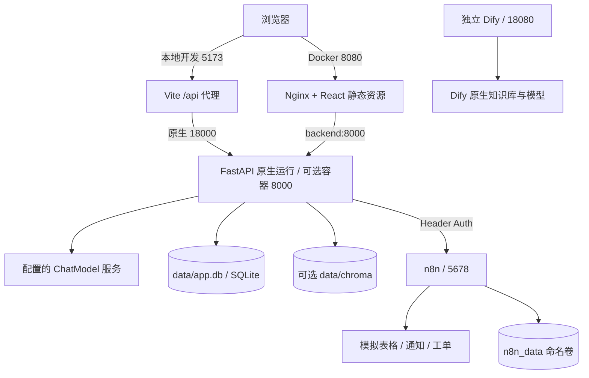
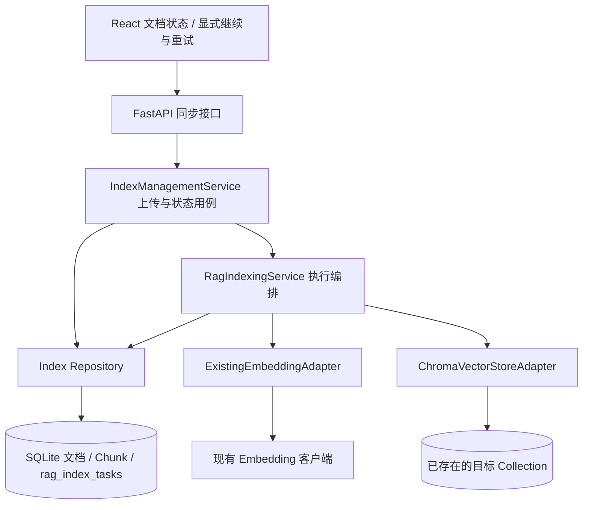
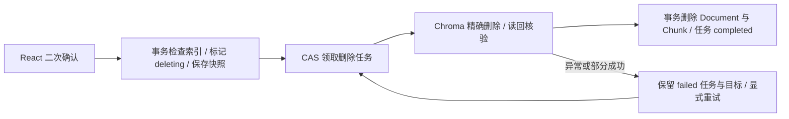
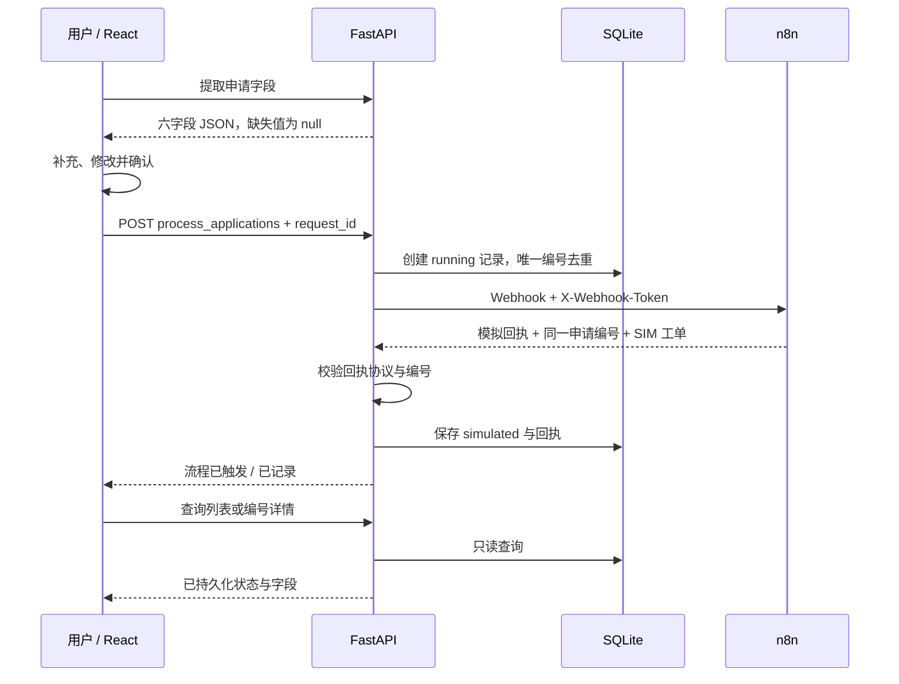

# 项目架构与数据流

当前主要入口是 React“知行工作台”。FastAPI 提供知识库、Agent、字段提取、流程提交与执行日志接口；Streamlit 是保留的旧版入口。Dify 单独部署，不参与原系统的请求处理。

## 部署视图

默认使用原生 Python + Vite，SQLite、ChromaDB 存储在本地目录，不要求 Docker。Vite 与 Nginx 是两种启动方式，按所选方式使用一个前端入口。Docker 仅作为可选部署方式保留。宿主机地址与容器服务名的区别见[部署说明](deployment.md)。

## 知识问答

1. 管理页将 `.md` / `.txt` 文本与分类发送至 `/index_document`，后端切块后原子保存文档、片段及 R1 索引任务，再按模式执行索引，详见下节。
2. Agent 对当前问题做业务分类与 Query Rewrite；模型决策失败时使用规则兜底。
3. `search_knowledge_base` StructuredTool 绑定当前请求的知识库和分类范围，只向调用方暴露 query。范围绑定不替代用户鉴权。
4. keyword 模式直接检索；vector 模式使用 Embedding 与 ChromaDB，按配置允许关键词回退。改写问题未命中时还可尝试原问题。
5. 命中片段进入模型上下文，回答按文件与 chunk 标签引用；无可靠片段时返回缺少依据的说明。即使命中片段，未包含所问细节时仍应拒答。
6. 前端通过 POST SSE 展示结果与证据；会话、消息、检索问题和命中片段保存在 SQLite。React 支持多会话及历史引用恢复。

## R1 索引管理

| 层 | 代码与职责 |
| --- | --- |
| API | `backend/api/chat.py`、`backend/api/rag_index.py`：请求校验、HTTP 映射、公开响应过滤，不直接操作 SQL |
| Service | `backend/services/rag_documents.py`：上传、作用域校验及状态投影；`rag_indexing.py`：领取、快照读取、Profile 核验与绑定、写入和结果确认 |
| Repository | `backend/db/index_repository.py` 复用 `repository.py` 的 connection-aware helper；负责短事务、CAS、稳定输入及状态，不依赖 Service |
| Adapter | `backend/rag/index_adapters.py`：复用 `embedding_client.py`、`vector_store.py`，验证向量数量、维度及 Collection 配置后 upsert；通过接口注入 Service |

文档、Chunk、任务同事务提交后才调用外部服务。向量模式创建 `pending`，关键词模式创建 `not_requested`；领取后 `attempt_token` 标识当前执行者，`state_version` 用于 CAS。执行时读取并校验输入快照，生成向量后、upsert 前绑定未知维度和距离度量，已知 Profile 配置禁止覆盖。成功确认 `ready`，异常记录 `failed` 及受控错误；写入成功但 SQLite 确认失败时返回“状态未确认”，不会伪报成功。

重试沿用原 operation/document/Chunk ID，向量 ID 为 `storage_session_id:db_chunk_id`，相同 ID upsert 覆盖，避免重复向量。同步 FastAPI 路由在线程池执行，Service 使用进程内执行名额及 120 秒协作预算；客户端断开不能证明外部调用停止，不自动抢占或重发，且预算无法强行中断所有底层同步调用。无 Redis、Celery 或后台队列。

React 用 `KnowledgeIndexController` 管理只读轮询、版本合并、取消及重复点击保护；`DocumentIndexStatus` 区分未启用、待执行、索引中、成功、失败和状态未确认。已领取 pending 只查询，未领取 pending 允许显式 resume，failed 允许显式 retry；HTTP 409 后只查询对账。人工恢复仅通过 CLI：确认所有旧执行者已停止后，将 claimed pending 标记 `failed/interrupted`，再显式 retry；它不能阻止仍存活的旧进程继续写 Chroma。

R1 不涵盖删除一致性、文档版本及权限重构，也不自动补齐历史任务或重建 Collection。历史业务 Collection 虽只读确认维度 1024、度量 l2，但模型来源不明，不能据此确认与新模型语义兼容。状态及接口见 [数据协议](data_contract.md#6-r1-索引任务与管理接口)，验收范围见 [记录](day27_delivery.md#r1-原生环境最终验收2026-11-03)。

## R2 单文档删除

沿用 API → Service → Repository / Adapter 分层：`backend/api/document_deletion.py` 负责 HTTP；`services/document_deletion.py` 校验权限、协调删除与确认；`db/deletion_repository.py` 管理 SQLite 事务、CAS 和独立任务；`rag/deletion_adapter.py` 只按稳定 ID 删除并读回核验，不调用 Embedding。

Document 的 `lifecycle_state` 为 `active/deleting`，与业务 `process_status`、R1 索引状态分开。删除请求在同一短事务中检查索引是否已领取、标记 deleting、保存完整 Vector ID/目标存储快照并使旧索引版本失效。独立 `document_deletion_tasks` 无 Document 外键，删除文档和 Chunk 后仍保留目标及回执。

已领取索引与删除互斥，返回 409；未领取的索引即使拿到新版本号，也因生命周期条件无法 claim/retry，删除中不能复用上传。SQLite 物理删除与任务 completed 同事务完成；Chroma 已删但 SQLite 失败时保留 deleting 和目标，重试可再次删除同一组 ID。SQLite 与 Chroma 没有跨库原子事务，采用可恢复的幂等流程；不会根据当前 keyword/vector 模式跳过历史向量清理。

关键词读取排除 deleting；向量检索先用 SQLite 活动文档 ID 白名单过滤，再回查 Chunk、正文与元数据；构造 Agent 上下文前再次核对。不存在或删除中的文档不能作为新检索证据，检索日志插入跳过失效 Chunk，避免删除竞争引发外键异常。历史已保存回答不在本轮自动清除。

React `DocumentDeletionControls` / `DocumentDeletionController` 提供确认弹窗、状态查询、失败重试和未领取 pending 的显式继续。claimed pending 只查询；删除通知通过 `KnowledgeIndexController.refreshAfterDocumentChange()` 使旧列表 GET 失效，再获取最新列表，避免删除成功后旧数据重新显示。

旧会话清空能力保留，API 与共享清理入口均拒绝 `knowledge_base:` 内部 session，不提供公共知识库批量清空。claimed 删除任务因进程中断停留时，操作人员确认旧执行者已停止后才能用 CLI 转 failed，再显式 retry；无自动超时接管或普通用户 recover API。接口、运行与验收分别见 [协议](data_contract.md#7-r2-单文档删除与生命周期)、[恢复操作](deployment.md#r2-删除任务与人工恢复)、[交付记录](day27_delivery.md#r2-单文档删除验收2026-11-04)。

## 流程申请

只有明确办理请求进入 `PROCESS_APPLY` 字段提取；财务制度咨询走知识问答。提取接口不创建申请、不触发 Webhook。提交必填申请类型、申请人和部门；其余字段可为空，不能凭制度默认值补造用户信息。

重复编号返回 409。超时记为 timeout，其他调用或回执异常记为 failed；这些状态不保证下游没有执行。回执成功但保存失败时不向前端报告成功，保留编号要求核对。服务、代理和前端都不自动重新提交流程。后端去重不等于跨系统 exactly-once，n8n 或实际业务系统仍需独立幂等设计。

前端在发送前将编号存入当前标签页 sessionStorage，离开页面或刷新后可恢复并查询；关闭标签页或清除存储会丢失本地恢复信息。日志页只聚合流程申请，未把全部 Agent/RAG 过程串成统一业务 Trace。

## 数据与代码归属

| 模块 | 主要位置 | 数据归属 |
| --- | --- | --- |
| React 工作台与 API 客户端 | `frontend-react/src` | 会话编号 URL、页面状态与申请恢复信息；会话消息及引用持久化到后端 SQLite |
| 路由、生成与字段提取 | `backend/services`、`backend/prompt` | 业务逻辑，不保存模型密钥到响应 |
| 检索与知识库 Tool | `backend/rag` | SQLite 片段与可选 Chroma 向量 |
| 数据库与流程记录 | `backend/db` | `data/app.db` |
| 回答反馈 | `backend/api/feedback.py`、`backend/db/feedback_repository.py` | 按 assistant 消息编号保存最新反馈；React 评测页只读汇总 |
| n8n 模板 | `integrations/n8n` | 模板无凭据；运行数据在命名卷 |
| Dify 复刻 | `integrations/dify` | 独立运行目录与插件卷，未打进应用镜像 |
| 评测 | `eval` | 独立临时数据库、语料哈希和逐题报告 |

评测直接复用 Agent 服务并消费 SSE 输出，未通过 HTTP 或浏览器重放。评测 Trace 属于报告，不等同于业务系统已拥有完整链路追踪。前端评测页从 Git 中的已验收报告构建快照，后端 API 不在线重跑这些指标。
