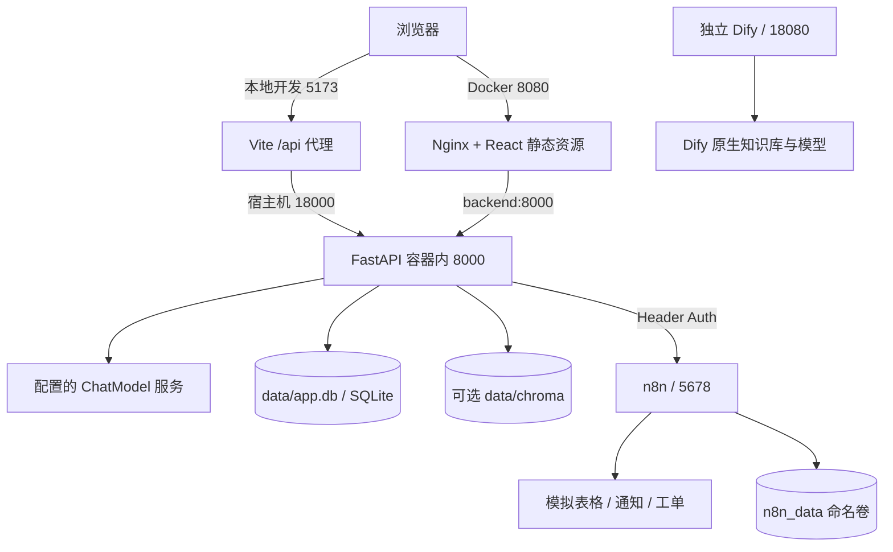
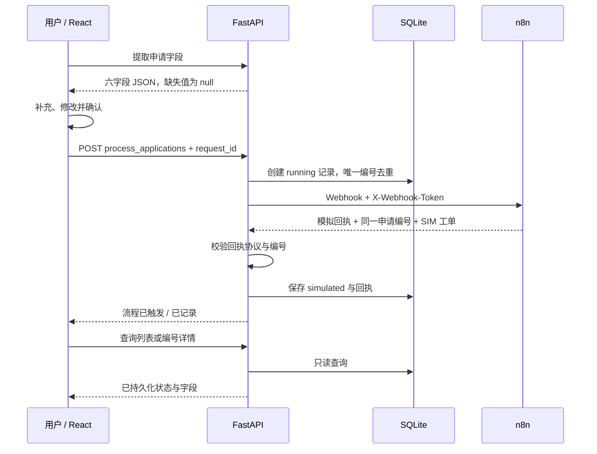

# 项目架构与数据流

当前主要入口是 React“知行工作台”。FastAPI 提供知识库、Agent、字段提取、流程提交与执行日志接口；Streamlit 是保留的旧版入口。Dify 单独部署，不参与原系统的请求处理。

## 部署视图

Vite 与 Nginx 是两种启动方式，按所选方式使用一个前端入口。Docker 端口绑定回环地址，默认是本机工作空间。宿主机地址与容器服务名的区别见[部署说明](deployment.md)。

## 知识问答

1. 管理页将 `.md` / `.txt` 文本与分类发送至 `/index_document`，后端按章节与段落切块，保存文档及片段。
2. Agent 对当前问题做业务分类与 Query Rewrite；模型决策失败时使用规则兜底。
3. `search_knowledge_base` StructuredTool 绑定当前请求的知识库和分类范围，只向调用方暴露 query。范围绑定不替代用户鉴权。
4. keyword 模式直接检索；vector 模式使用 Embedding 与 ChromaDB，按配置允许关键词回退。改写问题未命中时还可尝试原问题。
5. 命中片段进入模型上下文，回答按文件与 chunk 标签引用；无可靠片段时返回缺少依据的说明。即使命中片段，未包含所问细节时仍应拒答。
6. 前端通过 POST SSE 展示结果与证据；会话、消息、检索问题和命中片段保存在 SQLite。React 当前仍使用固定演示聊天会话，未完成多会话历史界面。

## 流程申请

只有明确办理请求进入 `PROCESS_APPLY` 字段提取；财务制度咨询走知识问答。提取接口不创建申请、不触发 Webhook。提交必填申请类型、申请人和部门；其余字段可为空，不能凭制度默认值补造用户信息。

重复编号返回 409。超时记为 timeout，其他调用或回执异常记为 failed；这些状态不保证下游没有执行。回执成功但保存失败时不向前端报告成功，保留编号要求核对。服务、代理和前端都不自动重新提交流程。后端去重不等于跨系统 exactly-once，n8n 或实际业务系统仍需独立幂等设计。

前端在发送前将编号存入当前标签页 sessionStorage，离开页面或刷新后可恢复并查询；关闭标签页或清除存储会丢失本地恢复信息。日志页只聚合流程申请，未把全部 Agent/RAG 过程串成统一业务 Trace。

## 数据与代码归属

| 模块 | 主要位置 | 数据归属 |
| --- | --- | --- |
| React 工作台与 API 客户端 | `frontend-react/src` | 会话编号 URL、页面状态与申请恢复信息；会话消息及引用持久化到后端 SQLite |
| 路由、生成与字段提取 | `backend/services`、`backend/prompt` | 业务逻辑，不保存模型密钥到响应 |
| 检索与知识库 Tool | `backend/rag` | SQLite 片段与可选 Chroma 向量 |
| 数据库与流程记录 | `backend/db` | `data/app.db` |
| 回答反馈 | `backend/api/feedback.py`、`backend/db/feedback_repository.py` | 按 assistant 消息编号保存最新反馈；React 评测页只读汇总 |
| n8n 模板 | `integrations/n8n` | 模板无凭据；运行数据在命名卷 |
| Dify 复刻 | `integrations/dify` | 独立运行目录与插件卷，未打进应用镜像 |
| 评测 | `eval` | 独立临时数据库、语料哈希和逐题报告 |

评测直接复用 Agent 服务并消费 SSE 输出，未通过 HTTP 或浏览器重放。评测 Trace 属于报告，不等同于业务系统已拥有完整链路追踪。前端评测页从 Git 中的已验收报告构建快照，后端 API 不在线重跑这些指标。
