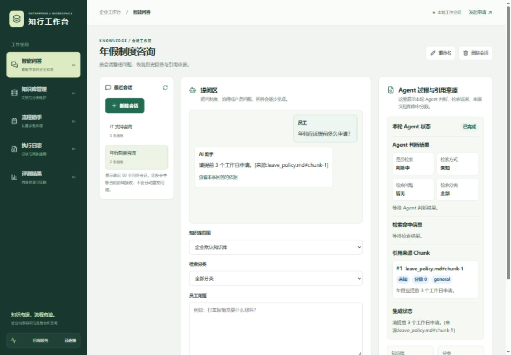
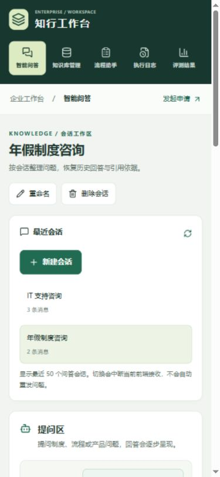

# 多会话管理与验收

React 的“智能问答”已使用服务端会话编号，取代固定演示编号。左侧显示最近 50 个“企业知识库问答”会话，包含新建的空会话；普通聊天和内部知识库会话不混入此列表。

## 操作步骤

1. 启动 FastAPI 和 React，进入“智能问答”，点击“新建会话”。空会话立即保存，页面地址出现 `?session=chat-...`。
2. 点击该会话名称右侧的“…”并选择“重命名”，在居中弹窗中输入“年假制度咨询”并保存。页面主标题固定为“智能问答”。输入“年假应该提前多久申请？”，等待回答完成。
3. 新建另一会话并提问，随后通过左侧列表切回。两边消息应各自独立；刷新浏览器后仍恢复当前编号的消息、名称和引用。
4. 点击某条回答下的“查看本条回答的依据”，核对对应来源片段。历史 Agent JSON 只展示最终正文，不直接展示步骤 JSON。
5. 在生成中切换会话，检查新页面没有出现旧会话的文字。切换会终止当前前端接收，不自动重发；旧请求可能仍在服务端完成。重新进入后可刷新历史核对。
6. 点击对应会话右侧的“…”并选择“删除”，应先出现写明名称与影响范围的二次确认弹窗，点击“确认删除”才执行。取消后会话保留。确认后会话、消息和临时文档删除，公共知识库文档及流程执行记录保留。生成中的会话禁用操作菜单。
7. 保持一个会话选中，从另一条会话的“…”执行重命名或打开删除确认，检查操作对象是菜单所在行，当前会话不会被切换。菜单支持点击外部、滚动或 Escape 关闭，方向键切换菜单项；手机端直接显示“…”入口。

历史末条只有用户问题时，页面提示“尚无已保存的完整回答”，不会把中断误报为回答成功。列表、详情和管理操作超时显示核对提示；流式断开或响应编号不符也显示错误，不自动重试。

## 接口与持久化

- `GET /chat_sessions?mode=企业知识库问答&include_empty=true&limit=50`：最近会话；不传新参数时兼容旧入口隐藏空会话的行为。
- `POST /chat_session`、`GET /chat_session/{id}`：创建与恢复消息、引用元数据。
- `PATCH /chat_session/{id}`：修改名称，去除首尾空格后要求 1–80 字。
- `DELETE /chat_session/{id}`：删除并保存删除标记；同一编号不可重新创建，迟到的流式写入不能复活会话。

SQLite 启动迁移自动创建 `deleted_chat_sessions` 表，不清除已有消息。删除标记与会话删除在同一事务中完成；流程执行表通过既有 `ON DELETE SET NULL` 保留审计。前端同时使用组件按会话编号隔离、AbortController 和 SSE 编号校验，避免旧异步结果进入新会话。

会话列表目前最多展示 50 条，未提供全文搜索或更早历史分页；切换会话会丢弃尚未发送的草稿。本项目尚无正式登录和员工级鉴权，多会话隔离指页面及数据关联隔离，不等同于多用户权限隔离。前端取消不承诺模型端立即停止计费。

## 本轮验证

- Python 全部 54 项离线回归通过，包含新增 6 项真实 SQLite/API 测试：空会话、模式筛选、名称校验、消息及引用恢复、公共知识库边界、删除与迟到写入。
- Node 原生测试 6 项通过：中文分字节及 CRLF SSE、无空行尾帧、跨会话编号、取消、断流、502 与非 SSE、历史正文及引用恢复。
- TypeScript、ESLint、Vite 生产构建通过。
- 浏览器使用 `tests/chat_ui_fixture.py` 的隔离 SQLite 和生产 HTTP/SSE 链路，模型输出为模拟；验证新建、命名、完整回答保存、刷新恢复、慢速回答中切换、历史引用、删除确认及取消。实际删除和公共文档保留由 API 测试覆盖。
- 1440px 桌面与 390px 手机布局检查通过；未启动 Docker、Dify 或 n8n，也未写入正常演示数据库。

可复现命令（项目根目录）：

```powershell
.venv\Scripts\python.exe -m unittest discover -s tests -p "test_*.py"
.venv\Scripts\python.exe tests/chat_ui_fixture.py
```

在 `frontend-react` 中执行 `npm test`、`npm run lint`、`npm run build`；浏览器验收时以 `BACKEND_PROXY_TARGET=http://127.0.0.1:18002` 启动 Vite。



