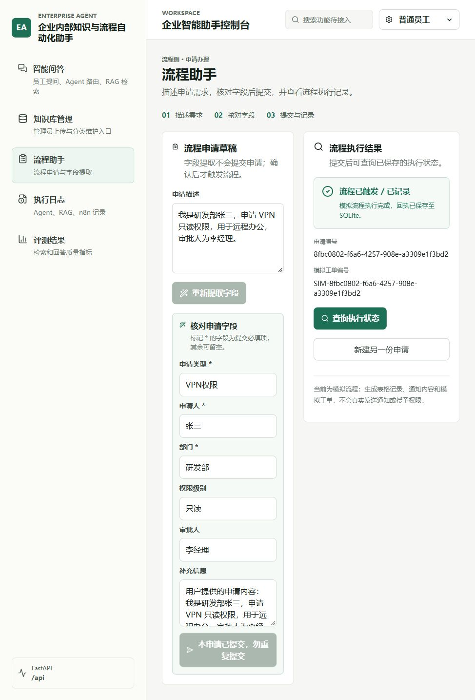

# 第 21 天：流程助手前端闭环验收

## 实现

- 新增 `POST /process_fields/extract`，请求为 `{"input_text": "申请原文"}`。复用模型字段提取服务；只提取、不执行 Webhook、不创建申请记录。空白输入返回 422，模型配置不可用返回 503，模型提取失败返回 502。
- React `/workflow` 页面替换本地正则提取，展示可编辑的申请类型、申请人、部门、权限级别、审批人和补充信息。
- 申请类型、申请人和部门必填；其余空值提交为 null。修改原文会清除原提取结果，需重新提取。
- 用户显式点击“确认提交”后才调用 `/process_applications`。后端回执成功并落库后展示“流程已触发 / 已记录”、申请编号和模拟工单编号。
- 请求期间禁用相关按钮并使用同步锁；提交后字段锁定，只提供查询状态，不自动重发。
- 发送前把申请编号和字段存入当前浏览器标签页的 sessionStorage。刷新或离开页面后返回时恢复编号，用户查询后从 SQLite 重新获取结果。关闭标签页/清除浏览器存储会丢失本地恢复信息，请自行保留重要编号。
- 超时、网络异常、409 或非预期回执不显示成功，保留编号供查询。查询不到记录也不自动重发。另建申请前需显式确认已核对原申请结果；该操作不是重试原申请。

## 启动与验收

1. 按第 19 天文档配置并发布 n8n 工作流、设置 Header Auth 及项目 `.env`。
2. 项目根目录启动 FastAPI：

   ```powershell
   .venv\Scripts\python.exe -m uvicorn backend.main:app --reload --host 127.0.0.1 --port 18000
   ```

3. 在 `frontend-react` 中运行 `npm run dev`。默认 `/api` 代理到 18000；更改后端地址可配置 `BACKEND_PROXY_TARGET` 并重启前端。
4. 打开 Vite 输出的前端地址，点击“流程助手”。输入：

   > 我是研发部张三，申请 VPN 只读权限，用于远程办公，审批人为李经理。

5. 点击“提取申请字段”，核对 6 项字段；可把部门改为“平台研发部”，确认页面允许修改。
6. 点击“确认提交”，等待“流程已触发 / 已记录”和两项编号出现；此时确认提交按钮应锁定。
7. 在 n8n Executions 核对同一个申请编号。点击页面“查询执行状态”，应仍为成功。
8. 刷新页面，编号和修改后的部门应恢复。点击“查询执行状态”，从 SQLite 找回成功回执。

## 异常用例

| 场景 | 预期 |
| --- | --- |
| 原文未提供申请人或部门 | 字段留空，确认提交禁用；补齐后可提交 |
| 提取失败 | 显示错误，不显示可提交的旧提取结果 |
| 修改申请原文 | 清除原提取结果，需要重新提取 |
| 提交中连续点击 | 同步锁与按钮禁用阻止第二次提交 |
| n8n 超时/断连 | 不显示成功，保留申请编号，允许查询，不允许直接重发 |
| 刷新或切换页面 | 恢复同一编号；不自动提交；查询后恢复实际状态 |
| 查询返回 failed/timeout/running | 展示对应状态说明，不当作“流程执行成功” |
| 需要另建申请 | 已成功时直接新建；结果不明时先核对，并勾选确认再另建 |

当前为模拟工作流，成功代表收到模拟回执且已持久化，不代表真实通知已发出、审批通过或权限已授予。

## 开发验证

```powershell
.venv\Scripts\python.exe -m unittest discover -s tests -v
```

前端在 `frontend-react` 下运行 `npm run build` 和 `npm run lint`。

浏览器隔离验收可在项目根目录运行 `.venv\Scripts\python.exe tests/process_ui_fixture.py`，并在另一个 PowerShell 的 `frontend-react` 目录运行：

```powershell
$env:BACKEND_PROXY_TARGET='http://127.0.0.1:18001'
npm run dev -- --host 127.0.0.1 --port 5175 --strictPort
```

此 fixture 仅用于测试：实际路由和临时 SQLite，模型与 n8n 为模拟。输入包含“缺失”时返回缺少申请人和部门的字段；包含“提取失败”时模拟非法模型输出；补充信息包含“超时”时提交返回 504。普通申请返回模拟成功。测试完成后停止两个进程，并在该终端移除 `BACKEND_PROXY_TARGET` 环境变量或关闭终端，避免后续开发误连测试服务。

浏览器已验证成功提交、字段编辑、缺失字段阻止提交、刷新恢复后查询以及超时状态处理。验收使用隔离环境，没有向实际 n8n 重复提交申请；真实配置下的最终验收按上面的启动步骤执行。

隔离环境验收截图：


