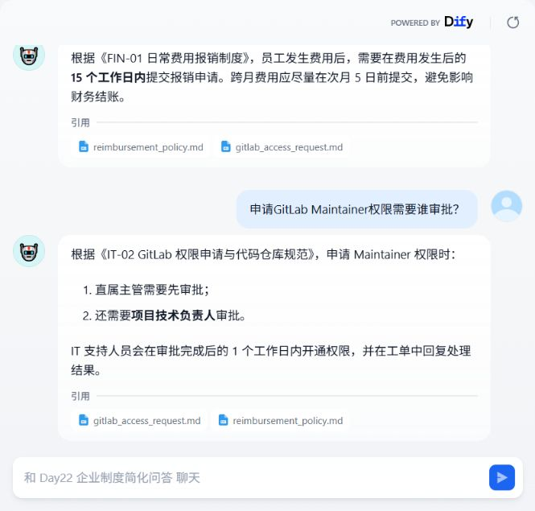
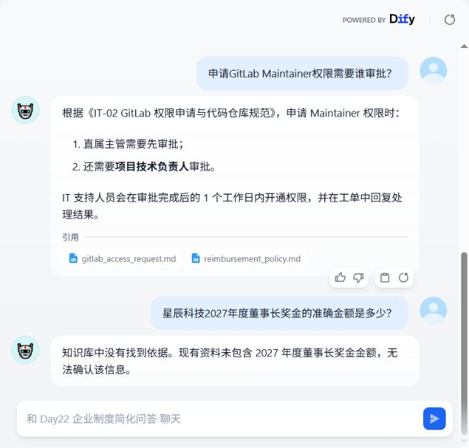

# 第 22 天：Dify 简化知识库问答验收

验收日期：2026-10-26（Asia/Shanghai）。本次使用实际本机 Dify 与实际模型 API，不使用模拟回答。

## 应用与范围

- 应用：[Day22 企业制度简化问答](http://127.0.0.1:18080/chatbot/2MDrJdPnndQQRPJZ)。该地址仅在本机部署运行时可用。
- 部署：官方 Dify 1.18.0，独立 Compose 项目 `enterprise-dify-day22`，入口绑定 `127.0.0.1:18080`。
- 模型：官方 Marketplace DeepSeek 供应商，`deepseek-flash`，temperature=0。
- 知识库：四份虚拟制度文档，Economy 关键词索引；不依赖原 FastAPI 的检索接口。
- 产出：[部署与复用说明](../integrations/dify/README.md)、[实际导出的 DSL](../integrations/dify/enterprise_knowledge_chatbot.yml)、[文档清单与哈希](../integrations/dify/documents.json)。

## 验收结果

真实 API 执行命令（在项目根目录）：

```powershell
.venv\Scripts\python.exe integrations/dify/run_eval.py
```

结果：5/5 通过，退出码 0。完整回答、来源与执行时间见 [实际 API 报告](../integrations/dify/acceptance_result.json)。

| 问题 | 预期与实际核对结果 | API | 浏览器页面 |
| --- | --- | --- | --- |
| 员工申请年假需要提前几个工作日？ | 至少提前 3 个工作日；有 `leave_policy.md` 来源 | 通过 | 通过 |
| 费用报销需要在几个工作日内提交？ | 费用发生后 15 个工作日内；有 `reimbursement_policy.md` 来源 | 通过（同义问法） | 通过 |
| 申请 GitLab Maintainer 权限需要谁审批？ | 直属主管与项目技术负责人审批；有 `gitlab_access_request.md` 来源 | 通过 | 通过 |
| VPN 提示 720 错误应该如何处理？ | 重启、禁用再启用 VPN 适配器，仍失败联系 IT 重装 | 通过 | 未重复测试 |
| 星辰科技2027年度董事长奖金的准确金额是多少？ | 明确回复“知识库中没有找到依据”，不编造金额 | 通过 | 通过 |

浏览器通过应用输入框发送问题，核对最终答案和引用显示；API 用例使用独立对话。浏览器截图：





## 交付检查与边界

已校验：88 个官方部署文件的 Git blob 哈希、Compose 配置、两个脚本的 Python 语法、四份原始文档 SHA-256、DSL 与 Prompt 一致性、引用开关，以及交付文本中是否出现已知本机密钥。`.env.local`、管理员信息、运行数据和官方下载副本均被 Git 忽略。

部署脚本负责准备及启动 Dify；管理员初始化、模型凭据、知识库创建和 DSL 导入按部署说明完成，不是一键重建全部应用数据。DSL 的知识库 ID 属于当前实例，迁移时必须重新绑定。请保存本机配置与数据；不要将初始化凭据提交到仓库。

Economy 检索的来源列表可能包含不相关文档，本次只证明预期来源出现且核心答案正确，不能据此宣称引用精确率 100%。五条样例不代表第 24～25 天的完整评测集，也不代表 FastAPI 与 Dify 效果相同。Dify 本次只实现知识问答，未接入流程申请、n8n 或权限变更。
