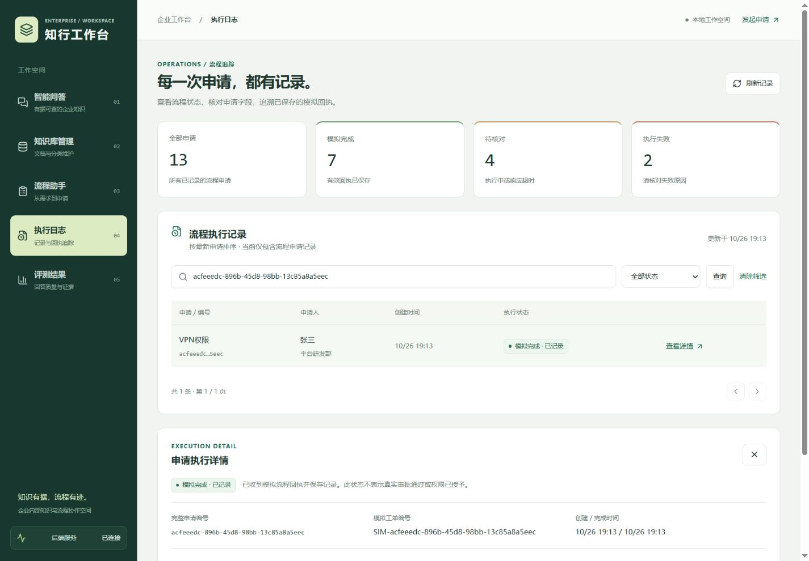
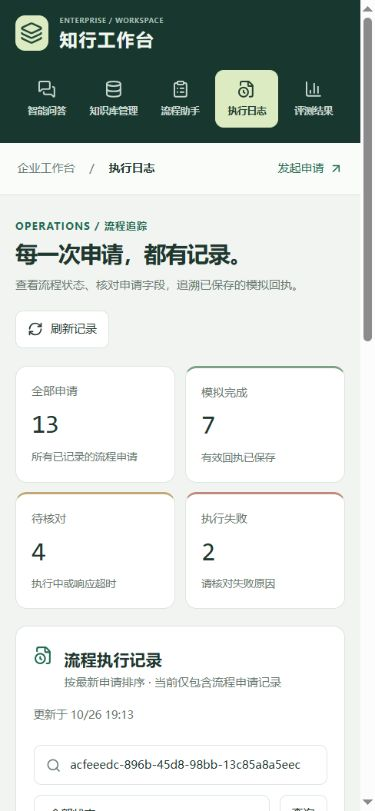
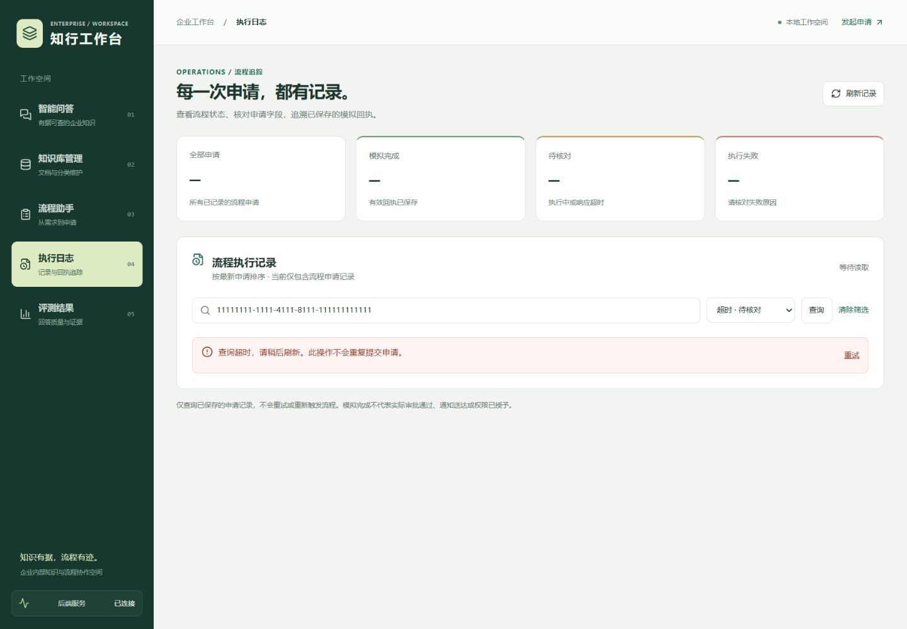

# 第 26 天：企业工作台 UI 与真实执行日志

验收日期：2026-10-26。

## 页面交付

- 统一深绿色导航、浅色工作区、卡片、输入控件、焦点描边与错误提示；手机端导航横排，表格在自身容器内滚动，支持减少动态效果的系统偏好。
- 公共框架改为“知行工作台”，显示当前模块与真实后端健康检查结果；移除没有功能的全局搜索和仅改变本地文字的角色选择器。知识库管理页原有的演示角色调用方式保持不变。
- 执行日志移除全部静态样例，读取实际 SQLite 申请记录，提供状态筛选、完整申请编号查询、分页、刷新及详情。统计卡片始终表示全部有效申请，列表数量表示筛选结果。
- 清楚区分模拟完成、执行中、失败和超时；超时提示先核对编号，不提供直接重发按钮。请求中、无记录、无匹配、接口错误和超时都有独立反馈；错误或加载中不显示旧统计或伪造记录。
- 流程助手保留字段编辑和重复提交保护，新增指向同一申请编号的日志链接。
- 评测页读取仓库已保存的修复后真实报告，替换旧静态数字。明确标注为构建时的验收快照，包含 83.3% 的六类路由匹配结果，不冒充实时生产指标。

## 新增只读接口

`GET /process_applications` 返回 `items`、筛选后的 `total`、`page`、`page_size` 和全局 `status_counts`。

| 参数 | 约束 |
| --- | --- |
| page | 默认 1，范围 1～100000 |
| page_size | 默认 20，范围 1～100；日志页面每页 10 条 |
| status | 可选 running / simulated / failed / timeout |
| request_id | 可选完整 UUID，精确查询 |

读取 `process_application` 工作流中具备申请编号及已知状态的记录，旧版无申请编号记录不冒充当前申请。按 id 倒序，统计与当前页处于同一只读快照内。列表只返回申请概要，不返回 Webhook 地址、凭据或原始响应；详情复用 `GET /process_applications/{request_id}`。过滤使用绑定参数，数据库不可用时返回脱敏 503，不触发 Webhook。

SQLite 时间按 UTC 解析后转换为浏览器本地时间。该页面目前只展示流程申请记录，尚未聚合聊天中的 Agent/RAG 全链路日志；沿用当前本机演示的访问方式，未新增登录或按员工隔离能力。

## 验证与复现

常规使用：启动实际后端（本机建议 18000），在 `frontend-react` 下运行 `npm run dev`，默认 `/api` 代理至 18000。通过流程助手实际提交后，在执行日志中核对同一编号。

隔离浏览器验收在项目根目录启动：

```powershell
.venv\Scripts\python.exe tests/workspace_ui_fixture.py
```

另一个 PowerShell 中：

```powershell
cd frontend-react
$env:BACKEND_PROXY_TARGET='http://127.0.0.1:18002'
npm run dev -- --host 127.0.0.1 --port 5176 --strictPort
```

fixture 使用真实业务接口和独立临时 SQLite，预置 12 条虚拟申请；模型与 Webhook 为模拟，不调用实际 n8n、不修改业务库。`--empty` 可启动没有流程记录的状态。仅该 fixture 暴露 `/__test__/availability`，允许测试 normal/error/slow 三种响应，不属于生产接口。

| 验证项 | 结果 |
| --- | --- |
| 后端单元测试 | 48 项通过；新增空库、分页、状态/编号交叉筛选、详情一致性、非法参数、异常脱敏及无副作用检查 |
| 前端检查 | TypeScript、Vite 生产构建、ESLint 通过 |
| 桌面浏览器 1440px | 列表、分页、全局统计、超时筛选、详情通过 |
| 网络异常 | 503 错误和超过 15 秒的查询超时均明确提示，恢复后可重试 |
| 流程到日志 | 修改部门后提交，成功显示编号，日志检索与详情保持同一编号、部门、工单；返回流程页仍禁止重复提交 |
| 手机浏览器 390px | 日志、问答、知识库管理、流程助手、评测页均无整页横向溢出 |

浏览器截图中的 13 条记录由 12 条 fixture 预置记录和 1 条通过页面提交的测试记录组成，均来自临时 SQLite；不代表实际业务历史或真实通知、审批、授权结果。当前浏览器验收未重新测试模型回答质量或实际文档上传，既有后端测试与前端构建用于回归检查。







结束隔离验收后停止测试进程，并移除测试终端的 `BACKEND_PROXY_TARGET` 或关闭该终端，以免后续误连临时服务。
