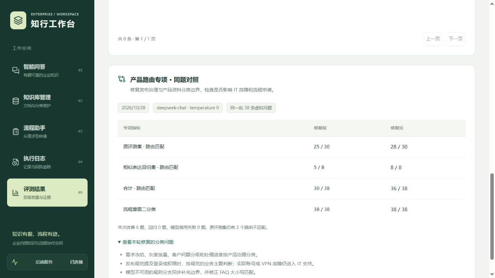

# 产品路由边界：修复前后实测

历史完整问答报告中的六类路由匹配为 25/30。有 3 道产品问题被归为 `knowledge_qa`：需求冻结、包含登录场景的灰度发布规范、客户反馈 P1 处理进度。另有设备安全和财务系统凭据问题各一处不匹配。本轮只修复产品分类边界，不改评测题、原有金标或历史报告。

## 改动与原因

模型提示补充业务分类原则：按问题核心对象和制度用途分类，不依赖是否出现“产品部”等名称。发布治理、需求锁定、分批开放和客户问题处理规范进入 `PRODUCT_DOC`；发布文档出现登录/权限词，不等同于当前账号或 VPN 故障。

降级规则同步识别发布治理主题，优先于其中偶然出现的 IT 词；实际 VPN 登录失败、升级后回滚客户端等问句仍进入 IT 支持。修正了输入转小写后仍匹配大写 `FAQ` 的问题。明确办理申请的判断仍优先，`use_rag=false` 继续关闭检索。

## 固定问题、同模型对照

| 范围 | 修复前 | 修复后 |
| --- | --- | --- |
| 原 30 题六类路由 | 25/30 | 28/30 |
| 8 题相似表达回归 | 5/8 | 8/8 |
| 合计路由匹配 | 30/38 | 36/38 |
| 是否流程申请二分类 | 38/38 | 38/38 |
| 模型调用/解析失败 | 0 | 0 |

两次均为 `deepseek-chat`、temperature 0、同一份 38 题清单，2026-10-28（北京时间）各执行一遍，改善 6 题，无正确变错误的题。`routing_before_report.json` 与 `routing_after_report.json` 保存逐题输出、模型名称、时间、问题清单和 Prompt 哈希。问题清单 SHA-256 为 `55c49b911b345e2564be5851a4a27922735fc40f85365f15d311d3ec1cc6e5e4`。

8 题在修复前已写入 `routing_holdout.jsonl` 并纳入基线，覆盖相似产品表达、真实 IT 排障、办理申请和财务咨询。它们是开发者定义的固定回归集，不是独立第三方盲测。单轮、有限样本不能证明线上所有场景或多次运行都具有同样准确率；模型服务也可能随时间变化。

两次总计 76 次分类请求，只发送虚拟问题与分类提示到项目配置的 `api.deepseek.com`，不发送制度全文、检索片段、答案或业务数据库。仓库评测说明明确这些姓名、部门、公司资料为虚拟演示内容。脚本仅调用生产路由中的模型决策函数，不生成答案、不执行 RAG 或申请，调用失败单独记错，不以降级规则冒充真实模型结果。

## 保留的失败与边界

- `it_05`：公司源代码同步个人 GitHub 的安全规范，仍为 knowledge_qa，金标为 it_support。
- `refusal_05`：财务报销系统管理员账号/初始密码，仍为 it_support，金标为 finance_process。该题存在“系统业务归属”和“技术凭据主题”的分类交叉，后续先明确原则，再修复；本轮不靠改金标提高分数。
- 这次结果不代表完整答案、引用、关键词覆盖或拒答指标已重新验收。原第四周完整评测报告和前端原始快照保留，前端另增“路由专项对照”说明范围。

## 复现与回归

项目根目录运行：

```powershell
.venv\Scripts\python.exe eval/run_routing_eval.py --output eval/local/routing_current.json
# 仅在固定模型、参数、同题清单下对照；会调用已配置的外部模型。
.venv\Scripts\python.exe eval/run_routing_eval.py --output eval/local/routing_current.json --compare eval/routing_before_report.json
.venv\Scripts\python.exe -m unittest discover -s tests -p "test_*.py"
```

离线回归共 79 项通过，新增产品路由边界与报告计算测试；覆盖 12 个产品/相邻意图问句、真实 Router 的降级入口、RAG 开关、相同参数对照、错误计数和已保存报告的一致性。前端检查与构建通过，浏览器核对专项表格及范围说明。正常演示数据库未修改，未启动 Docker、Dify 或 n8n。


