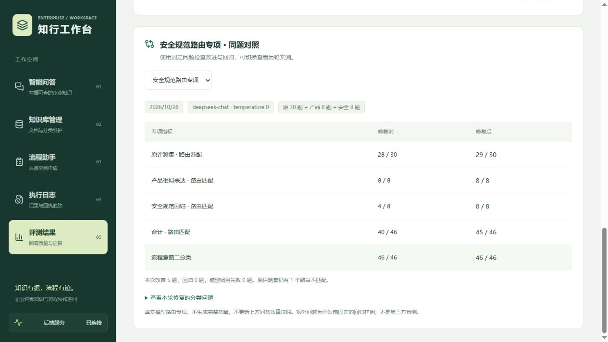

# 企业数据与设备安全路由修复

本轮处理上一轮剩余的 `it_05`：询问公司源码能否同步个人 GitHub，本应按 IT 安全制度检索，却被归为普通知识问答。修复前增加 8 条固定的虚拟问题，覆盖公司代码、客户业务数据、设备使用与资料交接，同时保留产品安全检查、年假和报销作为相邻场景。

## 改动

模型提示明确：企业数据与设备的使用限制、安全规范和交接要求属于 `IT_SUPPORT`，即使没有网络/账号词也需要企业知识依据；产品上线前的安全门禁仍属于发布治理。普通源码讲解、编程或工具用法不能仅凭代码/仓库词归为企业安全制度。

降级规则同步增加“企业范围 + 数据或设备对象 + 制度或使用动作”的组合判断，保持明确申请与产品发布治理的优先顺序。关闭 RAG 时仍保留业务分类并禁止检索。

## 同题真实模型对照

| 范围 | 修复前 | 修复后 |
| --- | --- | --- |
| 原 30 题路由 | 28/30 | 29/30 |
| 上一轮产品相似表达 | 8/8 | 8/8 |
| 新增安全规范回归 | 4/8 | 8/8 |
| 合计路由 | 40/46 | 45/46 |
| 流程意图二分类 | 46/46 | 46/46 |
| 安全回归集知识库开关 | 8/8 | 8/8 |
| 模型调用或解析失败 | 0 | 0 |

同一 `deepseek-chat`、temperature 0，两次各执行同一批 46 题；改善 `it_05` 和 4 个新增安全样例，无正确变错误。原始 30 题、上一轮 8 题及其金标保持不变，另 8 题在修复前固定。清单 SHA-256：`21e2cba90f7b86ba703c9495d19c8c5d458ea42198fc8a8d6da72edcd546d11d`。

`security_routing_before_report.json` 与 `security_routing_after_report.json` 保留逐题原因、耗时、模型、时间、问题清单及 Prompt 哈希。前端沿用一个“路由专项对照”入口切换安全规范/产品发布两轮报告，不覆盖旧报告。

本轮总计 92 次分类请求，仅向已有配置的 `api.deepseek.com` 发送分类提示与虚拟问题；没有发送实际源码、客户数据、制度全文、答案或业务数据库。8 条问题为开发者构造的固定回归样例，不是独立盲测；单轮有限数据不能证明所有安全问题都分类正确。

## 检索与剩余问题

增加真实 SQLite/关键词检索回归：使用样例 `device_security_policy.md`，确认修复后路由进入 IT 范围，命中安全文档，并排除测试中的 HR 干扰文档。这里只验证检索过滤和来源，不等同于重测完整模型答案。

`refusal_05` 仍不匹配：财务报销系统管理员凭据问题实际归 IT，原金标归财务。业务系统归属与技术凭据主题存在分类交叉，本轮继续保留，未改金标提高分数。分类不等同于可以提供凭据，缺少证据仍需拒答；完整拒答、引用与答案正确性指标本轮未重新实测。

## 验收与复现

83 项 Python 离线测试、8 项 Node 测试通过，类型检查、代码检查及生产构建通过。新增覆盖安全制度及相邻业务、普通代码例子不误归 IT、RAG 开关、IT 范围内实际检索及固定报告一致性。浏览器核对两轮切换后的表格和范围说明。

```powershell
.venv\Scripts\python.exe eval/run_routing_eval.py --extra-cases eval/security_routing_cases.jsonl --output eval/local/security_current.json --compare eval/security_routing_before_report.json
.venv\Scripts\python.exe -m unittest discover -s tests -p "test_*.py"
```

第一条会调用外部模型，只应用于确认可发送的虚拟数据。正常演示数据库未修改，未启动 Docker、Dify 或 n8n。


