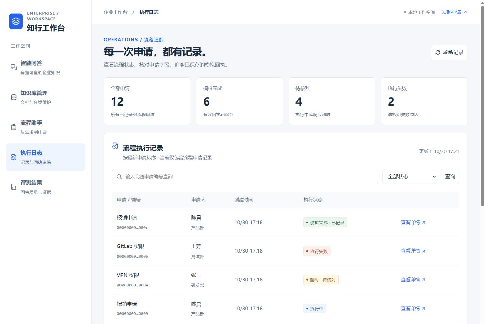
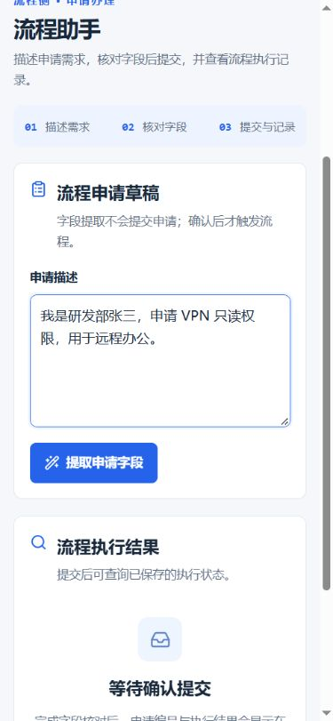

# 蓝色简约主题

将深绿主题调整为雾白底、白色侧栏和蓝色强调。保持上一轮的正文/输入框 16px、按钮/表格 15px、辅助文字 13–14px 的层级。

| 颜色用途 | 色值 |
| --- | --- |
| 主按钮、链接、品牌和重点图标 | `#2563eb` |
| 按钮悬停 | `#1d4ed8` |
| 导航选中、字段焦点等浅色衬底 | `#eff5ff` |
| 工作区底色 | `#f5f7fb` |
| 卡片和侧栏 | `#ffffff` |
| 主文字 / 辅助文字 | `#18283b` / `#5f6f85` |
| 分隔线 | `#e2e8f0` |

卡片采用细边框和轻阴影，统计卡片取消多色顶线；导航删除装饰序号和侧栏标语。用户要求移除的左下角“后端服务 / 已连接”组件及其前端自动查询已删除，后端健康检查接口保留。成功、超时、失败仍分别使用绿、橙、红语义色。

蓝色同时覆盖知识库选择、聊天消息、引用片段、流程步骤、表单焦点、空状态和反馈选择，避免局部残留旧主题底色。

## 验证

使用隔离 SQLite 与虚拟样例检查智能问答、知识库管理、流程助手、执行日志和评测结果五个模块。1440px 桌面和 390px 手机均无页面级横向溢出，正文/输入框维持 16px。确认“重新检查后端连接”按钮不再出现，导航和页面功能仍可访问。

TypeScript、ESLint、Vite 生产构建与现有前端测试通过。本轮未修改后端、模型或正常演示数据库。

开发模式刷新页面即可生效，缓存未更新时使用 Ctrl+F5。

