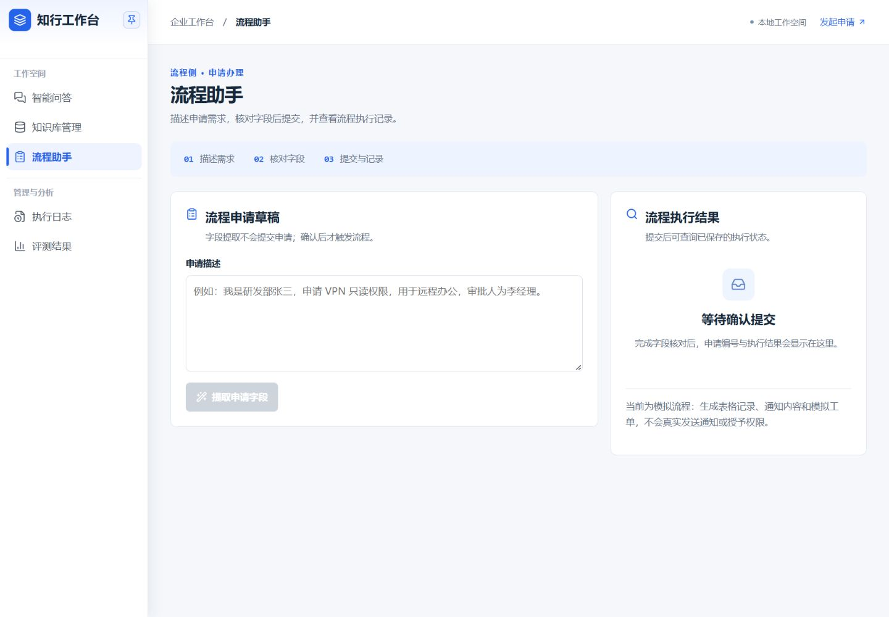
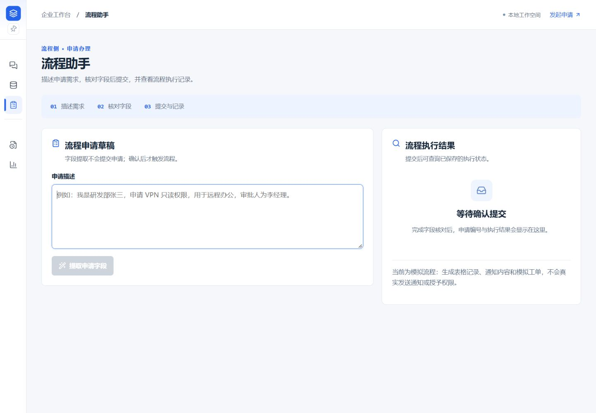

# 侧栏参考与交互

本次直接读取本机 `E:/Work/Projects/baide-erp` 的以下源文件作为参考：

- `frontend/src/layouts/ModuleShell.vue`：图钉固定、悬停展开、分组分隔线、圆角选中态、宽度与文字过渡。
- `frontend/src/styles/erp-ui.css`：展开 240px、收起 64px 的侧栏尺寸。

知行工作台保留自身 Logo、蓝色主题、五个业务入口和 16px 菜单文字。首次访问默认固定展开；右上角图钉取消固定后，鼠标移开自动收起，悬停或键盘进入可展开。再次点击图钉可保持展开，固定偏好存储在浏览器本地。关闭动画偏好沿用 `prefers-reduced-motion`。

为避免选择菜单时错位，展开与收起保留相同的品牌区和菜单纵向位置。手机端继续采用顶部紧凑导航。

验证：类型检查、ESLint、生产构建；桌面固定/取消固定/悬停/刷新恢复；390px 与 320px 窄屏无页面横向溢出。

