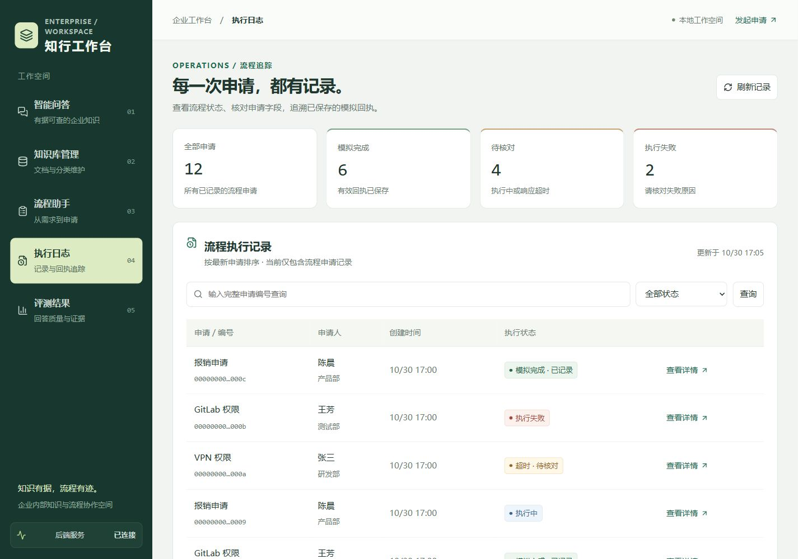
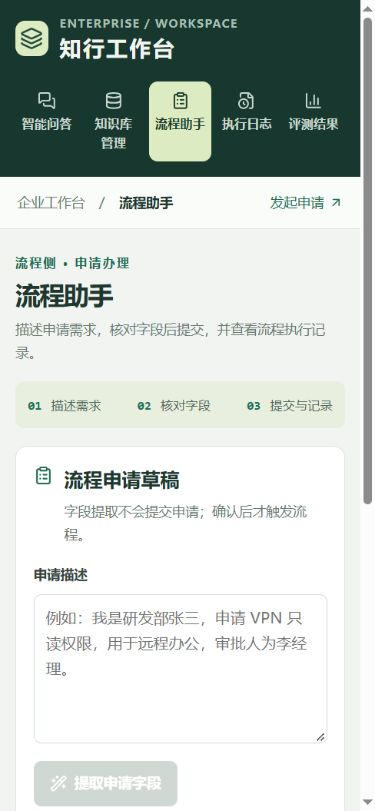

# 工作台字号与可读性

2026-10-30 统一放大智能问答、知识库管理、流程助手、执行日志和评测页的文字。原先大量正文说明、表格、标签采用 10–12px；本轮逐项调整，避免只修改根字号却被组件固定字号覆盖。

| 用途 | 默认字号 |
| --- | --- |
| 正文、聊天与表单输入 | 16px |
| 主按钮、表格内容 | 15px |
| 字段标签、表头、次级操作 | 14–15px |
| 辅助信息、状态标签、时间、编号 | 13–14px |
| 卡片标题 | 20px |
| 页面标题 | 桌面 30px，手机 26px |
| 指标数字 | 桌面 32px，手机 30px |

在 `workspace.css` 中统一维护 `--text-xs`、`--text-sm`、`--text-md`、`--text-base`，对应 13、14、15、16px 的默认字号；实际使用 rem，根字号 100%，跟随浏览器字号偏好。少量品牌英文标识为 12px，不用于业务正文。新增组件应复用这些字号，避免重新写入 10px 或 11px。

同步调整：桌面侧栏加宽，短屏保证导航完整可达；手机导航允许均衡换行、图标对齐；筛选控件和次级按钮最小高度 44px；输入框保持 16px，表格在容器内滚动，不通过缩小字号适配窄屏。后续蓝色主题保留字号层级，并移除了侧栏服务连接提示，见 [蓝色主题说明](ui_blue_theme.md)。

## 验证

- 浏览器检查五个模块的 1440px 桌面和 390px 手机布局，无页面级横向溢出。
- 实际计算样式：正文和输入框 16px、表格 15px、表头 14px、辅助说明 13px、卡片标题 20px、桌面页面标题 30px。
- 1280×720 笔记本高度下侧栏内容完整可达；320px 宽评测页没有页面级横向溢出。
- TypeScript、ESLint 与 Vite 生产构建通过。本轮只改样式，未修改后端、模型或业务数据；浏览器使用隔离 SQLite 验收。

开发模式保持 `npm run dev` 运行后刷新页面即可看到；缓存未更新时使用 Ctrl+F5。

